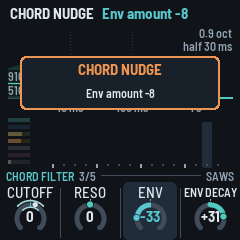
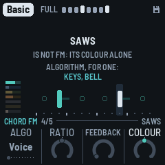
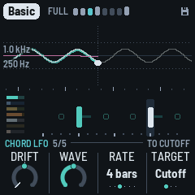
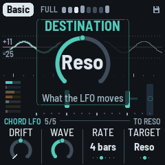
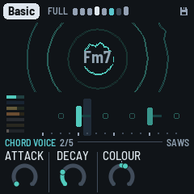

# DUB-1

DUB-1 (a working name) turns the M-VAVE FM-1 into a generative dub techno machine. It plays itself
from the moment it's switched on: chord stabs through a resonant low-pass into a tape echo, short
FM pings on loops of unequal length, a sub bass on one of five grooves, a kick that ducks the rest
(four on the floor, or sparser, a phrase at a time), a shaker and an open hat, and a crackle that
rings on the chord. An eight-bar arrangement takes the kick out for a break, thins the layers and
brings them back with a fill, and now and then a stab is thrown into the echo. The drums and the
bass play in phrases, a main bar three times and a variant on the fourth. You don't play it, you
steer it: pick a piece and a scale, take notes out, open the filter, push the feedback, hold the
echo, lock the groove.

DUB-1 is a fork of AMB-1, Charles Vestal's generative ambient firmware for the FM-1.

, running DUB-1, each control labelled")

---

## Contents

1. Install
2. Getting started
3. Controls
4. The screen
5. The layers
6. The arrangement
7. The pieces
8. The pages
9. MIDI
10. Saving
11. Troubleshooting
12. Parameters
13. Credits

**Cheat sheets:** fourteen one-page summaries, to print on A4 or keep open beside the FM-1:
<https://sbegueria.github.io/fm1-dub/cheatsheets/> (The panel, Arrangement, Chords, Chord voice, Pings, Bass,
Drums, Noise, The space, Effects grid, Variety, Songs and sets, Pieces, The screen).

---

## 1. Install

**Try it first** in the browser, with no FM-1: <https://sbegueria.github.io/fm1-dub/emu/>. It's the
same code the FM-1 runs, with sound.

**Install from the browser:** open <https://sbegueria.github.io/fm1-dub/install/> in Chrome or Edge
(they have Web MIDI), connect the FM-1 with a USB data cable, switch it on and press Install. Nothing
to install on the computer. Don't unplug it while it's writing; when it finishes, the FM-1 restarts
into DUB-1.

**Or from the command line:** download `dub-1.4.2.fwsc` from the
[releases](https://github.com/sbegueria/fm1-dub/releases), install Python 3 with
`pip3 install mido python-rtmidi`, and run, in a checkout of the source:

```
python3 tools/fm1_install.py dub-1.4.2.fwsc
```

**Go back:** the installer page's "Back to the stock firmware", or M-VAVE's own updater, M-UPGRADE,
puts the stock firmware back.

> Installing other firmware is at your own risk. If the FM-1 ever won't start, see
> [Recovering an FM-1 that won't start](#recovering-an-fm-1-that-won-t-start).

---

## 2. Getting started

DUB-1 starts playing as soon as it's on. A few minutes with it:

1. **Listen.** The first piece, Basic, is playing: F Dorian at 122, saw stabs into a dotted-eighth
   echo, an offbeat sub, the kick and a quiet shaker. Turn MASTER for the volume.
2. **Try another piece.** Turn PRESETS. Each of the eight pieces has its own key, tempo, sounds,
   groove and amount of movement.
3. **Change the scale.** Press a key whose note is lit: it leaves the scale, and nothing plays it
   any more. Press it again to bring it back. Any key that isn't lit adds its note.
4. **Move on.** Press EDIT: the chord moves to the next one at the start of the next bar.
5. **Hold the echo.** Press REC: dub hold. The echo stops listening and repeats what it holds,
   over and over, while the stabs, pings and drums go on dry above it. Press REC again to let it go.
6. **Shape a layer.** Each layer has a button: ENV the chord, ARP the pings, LFO the bass, SEQ the
   drums, SAVE the noise, FX the echo and the plate (the Dub page; again, the Echo page), HOME the whole
   (the Form page; again,
   the Key page: tempo, root, mode, swing), GLO the setup. The page's name is on the rule above the knobs, at its left.
   KNOB 1–4 set the four values at the bottom of the screen; while one turns, the line above them
   says what it does. SELECT is the DJ filter, on every page.
   Try Cutoff on the Chord voice page (ENV twice), or
   Feedback on the Dub page. Or turn SELECT (the Filter) down, and
   bring it back. On a layer's page, OCT− and OCT+ turn that layer down and up; both together, a
   quick press, mute it (and bring it back).
7. **Rest.** Press PLAY: the music stops and the echo and reverb ring away. PLAY again and it
   starts from the top of a phrase.

What you change is kept with the piece. DUB-1 saves it by itself while resting, or hold GLO for half a second (or turn Setup's KNOB 4).

Want a new colour? Hold a layer's button (ENV, ARP, LFO or SEQ) for half a second: its sound takes a small step somewhere new.

Like the groove as it is? Hold SEL for half a second: **Lock**. Each new phrase keeps the kick, the
drums' and the bass's patterns and the noise's groove until you hold SEL again.

---

## 3. Controls

The drawing at the top shows them all, each with its page or what it does (SEL's **Desk** is the Arrangement
page, the dub desk); here they are in more detail.

| Control | What it does |
|---|---|
| Keys | The scale. Each key adds its note to the scale or takes it out; the keys light up for the notes in it. Every octave of a note is the same key. The root stays ("THE ROOT STAYS"), and the scale keeps at least three notes ("3 NOTES AT LEAST"). |
| PLAY | Play / rest. DUB-1 starts playing by itself when it's switched on. At rest, the echo's feedback eases under 90% so its tails die away, the reverb rings out and the noise fades. Playing again starts from the first bar of a phrase. Lit while playing. In Song or Set mode (GLO again: [Songs](#songs-an-intro-the-main-an-outro)) PLAY starts a song from its intro, and the song stops PLAY by itself at its end (in a set, at each song's end with LP; with Segue or Mix only after the last piece). **HOME held + PLAY:** the **outro**, from the next phrase, in any mode (Endless too: a way to land a piece by hand); again, in it or while it waits: back to the main. |
| REC | A tap: **dub hold**: the echo stops listening and repeats what it holds, sample for sample, for ever; the reverb stops listening too and rings on; the chord doesn't move. The stabs, pings and drums go on, dry, above it. Tap again to let go. Lit while held. Held: the **effects grid** (below). |
| EDIT | A tap: the **Chords page** (below): the eight chords coming, to see and change (again: the **Walk page**, the circle of fifths; again, back). Held (half a second): the next chord, at the start of the next bar (at once while resting; in dub hold, once you let go); a card says NEXT CHORD until the chord changes. Held on (1.5 s): **new chords**, the walk's all walked again (yours, the gaps and the one playing kept); a red card, NEW CHORDS. |
| SEL | A tap: the **Arrangement page** (PERFORM's until 1.4.0): the screen shows each part's level on a desk's meters, the knobs are Width, Wet and Duck (KNOB 2 free: the dub mixer's rides are the Form page's Drift, its moves Motion's), and the keys stop being the scale: they mute and solo the parts (white 1–6 held: a part's channel strip; a black key held: that part thrown into the echo), make the dub moves, play four of the grid's effects and the dub sirens (see below). Again, it stays; a page's button leaves it (SELECT stays the DJ filter here too). Lit while on. **Held** (half a second), on any page: **Lock** on or off (below). |
| HOME | The **Form** page (Dub until 1.4.0): how the piece unfolds (Energy, Vary, Motion, Drift). Again: the **Song** page (its intro, main and outro, 1.4.0); again: the Key page (tempo, root, mode, swing), and again back to Form; HOME blinks on the Key page. Held on for 1.5 s (nothing turned meanwhile): **a shake of everything**, the chord, the pings, the bass, the drums and the noise at once ("SHAKE ALL"), the page kept; again and again, to explore until something sounds right. Held with SELECT turned: the tempo. |
| ENV · ARP · LFO · SEQ | The layers' pages: Chord, Pings, Bass, Drums, each its part (see [The pages](#8-the-pages)). Again: the layer's voice page (**Chord voice**, **Pings voice**, **Bass voice**; the drums' **Kick**), then its FM page or, for the drums, the **Hats** page and then the Pattern page, then back. The chord has one more: after its FM page (for every chord voice: its Colour is there), the **Chord LFO** page, then back. Held (half a second): a **nudge** to the layer's sound; held on (1.5 s): a **shake** (below). |
| FX · GLO | The **Dub** page, the echo and the plate (Space until 1.4.0; FX again: the **Echo page**, the echo's blur and tone, the plate's size and its cloud, FX blinking; again, back); the Setup page, for what holds for every piece (GLO again: **Song mode**, Endless, Song or Set, and a set's Transition, LP, Segue or Mix; again, back). The lit button shows the page. FX held: a nudge to the space; held on: a shake (a new echo time). **GLO held** (half a second, then let go): **saves** all eight pieces (a card, SAVED); held on (1.5 s): the piece back to its recipe (a red card, RESET). |
| SELECT | **The DJ filter**, on every page (its only place since 1.4.0's Chord pages; the Arrangement page's Open and Shut keys push on top of it): left shuts it (a low-pass, under water), right opens it (a high-pass, thin and bright), Off in the middle, where it stops on its way through (three clicks to leave it). While it turns, a big ring in the middle shows it (FILTER over it, the amount inside, Shut or Open under it); the page stays. Hold HOME and turn it for the tempo, from any page. The pages are on their buttons; the page's name, on the rule above the knobs, says where you are. |
| ALGORITHM | On a layer's page (Chord, Pings, Bass, Drums): that layer's **voice** (see [The voices](#the-voices)). On the Noise pages: its character. On the LFO pages: where the LFO goes, its **Target**, as their KNOB 4 (the Chord LFO's: Cutoff, Reso, Colour; the Noise LFO's: Filter, Tone, Air). On the Chords page: the walk's character (Home, Wander, Free). Anywhere else: the middle of the screen: ripples, a scope, a spectrum or the tape (see [The screen](#4-the-screen)). The mode, a piece's choice, is on the Key page (HOME again). |
| PRESETS | The piece (see [The pieces](#7-the-pieces)). |
| KNOB 1–4 | The four values on the screen. A few clicks are always single steps; a quick turn speeds up, so half a turn sweeps the range. While a knob turns, its value shows large in the middle of the screen, in a big ring with its name and what it does under it, on a panel that darkens what's behind it (on the Chords and Pattern pages, which show the change themselves, there's no big ring). Under the page, each knob is its name and one of three pictures, drawn for what it is: **a ring** for an amount (its **number** inside it only for a moment when the page opens, 1.5 s, then it fades; and in the big ring while it turns); **a ring with its unit inside** for an amount that has one (the strip's Filter "LP 2.6k", the song's bars, the Feedback's seconds; shortened to the figure where it's long); or, for a **choice** (a few positions, or named values: a voice, Wander, Four, 64 bars, Sine, the Root, the Mode), **the word itself, large**, with a dot for each option under it, the chosen one lit (a thin bar with its place past twelve). To see the numbers always, the Song mode page's KNOB 4 (GLO again), **Values: Always** (they show inside the rings). A knob with **zones** (Motion, the Drums page's Hits, the Bass page's Density) has its ring in segments, a gap where each zone begins; while it turns, the big ring names the zone and says what it adds. A **centred** knob (0 in the middle: the voice pages' −50…+50 ones, the chord's Cutoff, the Noise voice's Tone, the Filter, the Form page's Energy and the Arrangement page's Wet) has a **notch** at 0: turning through, it stops there, and to leave it takes three clicks the same way, each within 3 s of the last (the first two are held back: a slow turn, a click a second, leaves it; a stray click doesn't). A grey knob does nothing there. |
| OCT− / OCT+ | On a layer's page (Chord, Pings, Bass, Drums or Noise, and their voice, FM, Hats and Pattern pages, and the Noise pages): that layer's **level**, 5 down or up a press (a big ring in the middle, in the layer's colour, BASS over it, the level inside, until a second after the last press); held, it keeps going. **Both together**, let go within a second: the layer **muted** ("BASS MUTED"), its level kept; again, back ("BASS ON"). The drums mute the kick and the hats together. These are the Arrangement page's mutes (white 1–6): a mute made here shows there, and the other way round. Held together for five seconds: the update mode (see [Troubleshooting](#11-troubleshooting)); a long press never mutes. On the other pages they do nothing. (The pings' octave is on the Pings voice page, KNOB 1.) |
| MASTER | Volume. |
| SAVE | The **Noise page** (below: its part); again, the **Noise voice** (its Air, Tone, Decay and Width; SAVE blinks); again, **Noise LFO** (its wave and wander, as much as Drift says, on its filter, its Tone or its Air); again, back to the Noise page. (Its sends are its channel strip's, on the Arrangement page.) Held: a nudge to the noise; held on (1.5 s): a shake (another noise character). Saving is on GLO. |

**One rule for the buttons:** a button with one page stays on it when you press it again
(SEL); a button with several steps through them (HOME: Form, Song, Key; EDIT: Chords, Walk; GLO: Setup, Song mode; FX: Dub, Echo; SAVE: Noise,
Noise voice, Noise LFO; a layer's: its page, its voice page, its FM page; the drums': Drums, Kick, Hats,
Pattern; the chord's, Chord, Chord voice, Chord FM and Chord LFO). To leave a page, press
another page's button.

**The Arrangement page** (SEL; PERFORM until 1.4.0). The mixing desk: the screen shows every part's
level, and the knobs act on the whole music. Wet is 0 in the middle (the piece as it is), with the
notch there, so it's easy to find:

| Knob | Down | Up |
|---|---|---|
| KNOB 1 · **Width** | the whole mix narrower, to mono at 0 (the lows are always mono) | wider: the echo's right side a few milliseconds behind its left, a slow crossed chorus on the stabs and the pings; at 100 as wide as the widest records (Fog and Night Drive have 85) |
| KNOB 2 | free (the dub mixer's, until 1.4.0's variety plan: its rides are the Form page's Drift now, its moves Motion's, below) | |
| KNOB 3 · **Wet** | the whole music drier: the chord and the pings up front, less into the echo, the noise dry | the whole music drowned: the chord and the pings almost all echo, more into the echo, the noise into the echo and the plate |
| KNOB 4 · **Duck** | 0: the music still, the kick on top of it | up to 100: each beat pushes the rest down, to −12 dB, the music pumping |

**Width** is the desk's master stereo field, the piece's own, saved with it (the Echo page's until
1.4.0's space pages). **Energy**, here until then too, is on the Form page alone (HOME): one value, in
one place. The Filter isn't here any more:
it's on SELECT, on every page. The Open and Shut keys push on top of it. **Wet** moves the chord's
and the pings' dry against their sends (each piece's own balance, on no knob) and the echo's send
together, and the noise with them (its dry down, its plate and echo up): one knob for the whole
music, dry and close or lost in the echo. It's an offset on top of everything else, the channel
strips' sends included (below), which stay where they are. Wet is for playing: it isn't saved, and it
stays where it is when you change piece, back in the middle when the FM-1 starts.

**The virtual dub mixer** is the desk riding itself, as a dub engineer's hand on the faders and the
sends. How far its slow rides go is the Form page's **Drift** (1.4.0, the variety plan; its own knob
here before, Mixer): the same amount that moves the LFOs and the filter's sweeps (Chamber's least, 30;
Fog's most, 100). Its moves (below) are the Form page's **Motion**, its first zone, Breathes (the
variety plan's step 3): Haze's fewest (Motion 4), Fog's most (42). At Drift 0 the desk stays where you
set it; at Motion 0 nothing is ridden out.

- **The rides:** each part's level, its echo send and its plate send, the chord's filter and the
  echo's feedback move slowly, each to a new place every 10 to 60 seconds, gliding there over most of
  the wait. They start anywhere in the bar, not on the phrases' lines: about one in eight lands on one,
  as chance would have it (the records' changes about a quarter, DUB-1's own arrangement nearly half).
  How far they go is Drift's: at 100 a level from −1.5 to −7 dB down and +1 to +3 dB up, never more;
  a send −8 to +6 dB; the filter half an octave either way. The kick moves least (its level only,
  ±1.5 dB): it never leaves the classics.
- **The moves** (Motion's): now and then, one thing more: a part ridden right out and back over a few
  bars (the pings, the hats or the noise; the chord or the bass down 12 dB, never out, the bass more often
  as Motion rises), or a part's echo send swelled for a bar or two (the chord's, the pings', the hats' or the
  noise's), the feedback with it, the repeats left to ring. One at a time: about one a minute at Motion
  40, growing straight from none at 0, and up to one and a half a minute at 100. Half of them start on a
  phrase's line, half anywhere. The kick isn't ridden out: Motion has its own drop-out for it (see
  [The arrangement](#6-the-arrangement)).
- **Around your settings:** the rides move offsets around the knobs; your values stay as you set them.
  Turn a Level and the ride goes on around the new one.
- **When it rests:** the moves come only in Full and Groove phrases, never in a Break or a Thin, and
  not in a song's intro or outro (the song's; its rides are half as deep there); **Lock** and dub hold
  rest it all (nothing new; what's under way ends). Drift turned to 0, every ride glides home over four
  bars; Motion turned to 0, a move under way goes back.
- **On the screen:** the meters' white notches move with the rides, where each part's level is now; a
  held strip's Level, Echo and Plate knobs show the ride as the LFO's moving knob does: a band from
  your setting to where the ride has it, a white dot there.


**Duck** is the piece's own (it was the Drums page's KNOB 4 until 1.3.0), saved with it: how far
each beat pushes the rest down, letting it back in over a little more than a tenth of a second. A
kick ducks it fully; a beat without one a little less, and less again while the arrangement has the
kick out (a Break), so the music keeps breathing (the ghost duck). The noise is ducked deeper than
the music.


**The meters.** A row a part, top to bottom, as the white keys 1–6: the chord (CHD), the pings (PNG),
the bass (BAS), the kick (KCK), the hats (HAT: the shaker and the open hat, with the rim and the clap),
the noise (NOI), and under them the master (MST). Each row is a meter of LED segments, left to right, from −48 dB to 0 dB, 2 dB a segment:

- **The lit segments:** the part's level as it plays, its peaks: up at once, falling back at about
  20 dB a second. The parts are measured dry, as each goes into the mix (their echo and plate are
  in the master, not in their rows), before the duck; the master as it goes out, after MASTER.
- **A lone segment above them:** the peak held, for a second; then it falls back.
- **The white notch** through a row: the part's level setting (its strip's Level, below; OCT− / OCT+ on
  its page), as a fader's position, 0 at the left, 100 at the right. Turn a level and it moves; the
  dub mixer moves it too, where its ride has the level now. The
  kick's and the hats' are their own faders, 50 in the middle as the piece has them; the drums' level
  (OCT− / OCT+ on the Drums pages) moves both.
- **Colours:** green, yellow from −12 dB, red in the top 4 dB, on every row. (A test build can
  colour each row in its layer's colour instead, the master white, its top two segments amber and red;
  the release has the classic colours.)
- **A muted part's row is dark** (its notch kept, grey); with a **solo** on, the rows soloed out are
  dimmed, the one you hear bright.
- **DUCK**, under the master, a row as the others: the duck, as a compressor's gain reduction, eating segments from the
  right with each kick (2 dB a segment): on the bass while it plays (the deepest, the pump you
  hear), else on the rest of the music. Duck at 0, it stays dark.
- **Red at the top of MST** means the output is at full scale: the soft clip is squashing it, and
  a red **!** lights in the header, on every page, for a second (turn MASTER or a level down).

On the Arrangement page, each key says what it did on a card in the middle for a moment (under a second, so the
meters under it show the effect): a mute ("PINGS muted", in the part's colour), a solo, a move as you press it
("CHORD THROW: every stab into the echo"). A page's button **leaves the Arrangement page**: the keys are the scale again
(the mutes and solos stay), and SEL brings it back.

**Hold white 1–6** for a part's **channel strip**, as on a mixing desk: KNOB 1–4 that part's
**Level**, **Echo** send, **Plate** send and **Filter**, until you let go. White 1 the chord, 2 the
pings, 3 the bass, 4 the kick, 5 the hats (with the rim and the clap), 6 the noise: the meters' rows,
top to bottom. The strip comes up after a third of a second held, or at once if you turn a knob; its
name shows on the rule above the knobs ("KICK STRIP"), its row on the meters is lit behind, its knobs are in
its colour, and the big ring names what you turn ("HATS ECHO"). Let go and you're back on the
Arrangement page. A **tap** still mutes the part: the mute comes as you let go (a hold mutes nothing).
(Until 1.4.0's last builds, white 6 held was the Mix page, the four levels on the knobs: each part's
Level is its strip's now, the noise's too.)


| Knob | What it does |
|---|---|
| KNOB 1 · **Level** | the part's level: the same as OCT− / OCT+ on its page (the noise's too). The kick's and the hats' are their own: 50 as the piece has them (×1), about 12 dB down at 0 and 12 dB up at 100; the hats' is the Hats page's Level (the shaker and the open hat; the rim and the clap go with the drums' level, OCT− / OCT+ on the Drums pages, which moves the kick and the hats too) |
| KNOB 2 · **Echo** | how much it sends into the echo: 50 as the piece sends it, 0 none, 100 twice as much (+6 dB). The bass sends none in every piece (0): turn it up for a dub bass throw. The hats' is the hats', the rim's and the clap's. The kick sends none in every piece (0): turn it up and it goes into the echo too (100 a full send) |
| KNOB 3 · **Plate** | how much it sends into the plate, the same way: 50 the piece's, 0 none, 100 twice (the kick's from 0, as its Echo) |
| KNOB 4 · **Filter** | a filter on the part, before its sends (so its echo and its plate are filtered too), centred like the DJ filter: **0 off** (nothing run). **Left, a low-pass** (12 dB an octave; 6 dB while the FM-1 is near its limit, the engine shedding work, then 12 again): the part darker, from about 18 kHz at −1 to about 200 Hz at −50 ("LP 800"). **Right, a high-pass** (6 dB an octave, as the Low cut was): the part thinner, from about 20 Hz at +1 to about 2.5 kHz at +50 ("HP 290"); the old Low cut's 600 Hz is near +36. The chord keeps its own gentle cut at about 160 Hz under it; the kick's leaves the rumble be (its own knob, on the Kick page). (Until 1.4.0's last builds, the Low cut: the high-pass alone, 0–100) |


A thrown stab (and any part thrown with its black key) still goes into the echo whatever its strip's Echo, and the Arrangement page's Wet
moves everything on top. The strips are the piece's, saved with it.
A page's button goes to its page (HOME: the Form page). The keys, from the lowest up, are the parts (a black key a
part's solo and throw), two empty white keys, the global moves, then four of the effects grid's effects; the
four right-most black keys are the dub sirens.
Each key that does something is lit:

| Keys | Notes | A tap | Held |
|---|---|---|---|
| **White 1–6** | F3 G3 A3 B3 C4 D4 | mutes the chord, pings, bass, kick, hats, noise (and back) | that part's channel strip on the knobs (above) |
| **Black 1–5** | F♯3 G♯3 A♯3 C♯4 D♯4 | solos the chord, pings, bass, hats, kick (and back) | **throws** that part into the echo while held |
| **White 7–8** | E4 F4 | the gap: dark, does nothing | |
| **White 9–12** | G4 A4 B4 C5 | | the global moves: **Open**, **Shut**, **Drop**, **Echo** |
| **White 13–16** | D5 E5 F5 G5 | | four effects: **Time x2**, **Freeze**, **Tape stop**, **Stutter** |
| Black 6–7 | F♯4 G♯4 | nothing (dark) | |
| **Black 8–11** | A♯4 C♯5 D♯5 F♯5 | a short **dub siren**: **Wail**, **Whoop**, **Hi-lo**, **Laser** (about a bar) | the slow one, looping until you let go; its page: the knobs its Pitch, Rate, Depth, Echo |

The first four black keys belong to the white key on their left: F♯3 the chord (F3), G♯3 the pings, A♯3 the bass,
C♯4 the hats (C4). The kick's white key (B3) has no black key after it, so the last one, D♯4, is the kick's (1.4.0:
it was the noise's; the noise has no solo or throw now, white 6 still mutes it).
White 7 and 8 (E4, F4) are dark and do nothing: the gap between the parts and the moves, so you can find them
without looking. (1.4.0: the gap was one key; the Siren's key went and the moves and effects moved one key up.)

- **White 1–6, the chord, pings, bass, kick, hats and noise:** a tap mutes the part, another brings it
  back (the mute as you let go: held, the key is the part's channel strip, above); lit while it plays.
  The levels stay as they are (a true mute: the strips' Levels don't move). They
  are the same mutes as OCT− + OCT+ on a layer's page (there, the drums' mute is the kick's and the
  hats' together): a mute made either way shows on the other. The mutes stay when you leave the Arrangement page.
  The music goes on underneath: a muted part comes back where it would have been.
- **Black 1–5, a tap: solos.** A tap solos the part: the others go quiet (their echoes and reverb ring out). Solo
  more than one and they play together; tap again to let one go. A soloed key blinks; the white keys show what you
  hear. SOLO shows in the header, at its right end. Solos stay when you leave the Arrangement page, as the mutes do.
- **Black 1–5, held: throws** (past a third of a second; the key goes dark while it throws, and the release
  solos nothing). As a dub engineer slams a part's aux: the part goes into the echo at its own level while you hold
  it, whatever its strip's Echo and the piece's Echo (even at 0), and the echo's feedback climbs towards its top, so
  the repeats stack up over each other (the loop's soft clip keeps them in); the strikes stop ducking the repeats.
  It comes in over about 15 ms; let go and it leaves over about 60 ms, the feedback back where it was and the
  repeats ringing on. The **chord**'s also throws every stab ("CHORD THROW: every stab into the echo"), with the
  second head. The **pings**, the **hats** (with the rim and the clap) and the **kick** go in as they are. The
  **bass** goes in driven, as an overdriven aux: the echo takes nothing under about 350 Hz, so a round bass (Sub)
  would throw almost nothing; driven, its harmonics are heard. (1.4.0: the throws were nearly inaudible before:
  they went through the piece's Echo and the strip's send, the bass and the hats 10 to 25 dB under the part.)
- **White 9–12, the global moves, held** (lit; dark while held):
  - **Open:** the music thins and brightens over the kick: a resonant high-pass on everything but
    the kick sweeps up to about 400 Hz, and the chords' filter opens three octaves and sings, the
    echo's band-pass and the pings brighter with it.
  - **Shut:** the music goes under water while the kick keeps pumping: a low-pass on everything but
    the kick sweeps down to about 230 Hz, the chords' filter and the echo's band-pass closing with it.
  - **Drop:** the floor falls away: the kick and the bass out while held (the bass let go at once),
    both back on the next beat when you let go. The kick's mute (white 4) takes it out until you
    press again; Drop is the move you hold for a bar or two and release on the downbeat.
  - **Echo:** the echo pushed: everything into it, feeding back more.
  - Each sweeps in over about half a second; letting go eases back (to where the Filter knob is).
- **White 13–16, four effects, held** (lit; dark while held): **Time x2**, **Freeze**, **Tape stop**
  and **Stutter**, the same as the effects grid's (REC held, below), one key each
  and nearer to hand. They play together with the grid's.
- **Black 8–11, the dub sirens** (lit; dark while one sounds). One siren voice. Wail, Hi-lo and Laser are tuned to
  the piece's key: their turning points are the root, the fifth and the octave (the mode's fifth: a flat fifth in
  Iwato), and they slide between them. **Whoop is out of tune on purpose**: the classic dub siren box, which knows
  nothing of the key, clashing with it (its own pitch, A3 and 40 cents, about 225 Hz, a shade under a quarter-tone off
  every key's notes; turn its Pitch to sweep it into the key by ear). Each goes into the echo as the grid's Siren does
  (at the piece's Echo), at about its level, so its tails ring on after it. **A tap** plays a short one, about a
  bar, to its end even though you let go at once. **Held** past a third of a second, it turns into the slow one from
  where it is (no jump) and loops until you let go; then it fades over about 150 ms and the echo carries the tail. A
  new siren takes over from the one sounding. Wail and Hi-lo follow the tempo; Whoop and Laser don't.

  | Key | Siren | A tap | Held |
  |---|---|---|---|
  | A♯4 | **Wail**: a near-sine tone gliding root, fifth, octave and back, lingering on each | one rise and fall over a bar | one rise and fall every 4 bars |
  | C♯5 | **Whoop**: a box's whoops, each rising an octave quickly and dropping back, out of tune | a burst of whoops, 2.5 a second (three: 1.2 seconds) | whoops on and on, 2.5 a second, their floor rising a fifth over 4 seconds and back over 4 |
  | D♯5 | **Hi-lo**: the root and the fifth swapped, square-ish (the old police siren) | a bar of swaps, one a corchea (8th) | swaps a negra (quarter) each, the pair rising to the fifth and the octave over 4 bars and back over 4 |
  | F♯5 | **Laser**: a fall from two octaves up to the root, warbling (6 a second) | one 1.5-second drop | 8-second falls, half a second on the root fading, then again |

  **A siren held is its own page** (as a white key held is a part's strip): the knob strip shows
  **SIREN · WAIL** (or WHOOP, HI-LO, LASER) and the four knobs ride that siren while you hold it. Let go: the siren
  fades as above and the screen goes back to the Arrangement page. Each knob shows the big ring as it turns (its
  name, its value: "Pitch +3", "Rate 1/8", "Rate 4.0 Hz", "Depth 12 st", "Echo 70"); the reader says them.

  | Knob | | Wail | Whoop | Hi-lo | Laser |
  |---|---|---|---|---|---|
  | 1 | **Pitch** | an octave down to an octave up, a note of the key a click | the same, free: a tenth of a semitone a click | as Wail | where it lands, on the key's notes |
  | 2 | **Rate** | one wail held, a note value: a semicorchea (16th) to 8 bars (4 bars; a tap a quarter of it, as many as fill a bar) | whoops a second, 0.2 to 12 Hz (2.5), tapped and held | one swap held, a semicorchea (16th) to 4 bars (a negra (quarter); a tap half of it, a bar's worth) | the warble, 0.2 to 12 Hz (6); the fall's time stays |
  | 3 | **Depth** | its top, 1 to 24 semitones on the key's notes (12: the octave; its middle the fifth, else the note nearest 7/12 of it) | how far each whoop rises, 1 to 24 semitones (12) | its other note, on the key's notes (7: the mode's fifth) | how far it falls, on the key's notes (24: two octaves) |
  | 4 | **Echo** | its send into the echo, 0 to 100 (50: as before). Past 50 the echo's feedback is pushed too, as a throw's, so the repeats stack and ring on after it (the push eases out over about a second) | | | |

  The values in brackets are where each starts: the sirens exactly as they were before the knobs (Whoop's new
  sound aside). Each siren keeps its own four settings, as a box's knobs stay where you left them: its next tap or
  hold starts from them. A tap uses them; the knobs move them only while the key is held. They are saved with the
  project and the same for every piece (format 34; an older save gives them as they start). On the tuned sirens
  Pitch and Depth step through the key's notes, so a piece in another key keeps them in its own; when the scale
  changes they move to its nearest note. Pitch has the centred knobs' notch at 0.

  The effects grid's Siren (REC held, key 15) is unchanged. Leaving the page lets a held siren go.
- The other keys (F♯4, G♯4) do nothing on the Arrangement page; MIDI notes in still change the scale.

**Lock** (SEL held for half a second, on any page; held again, off). The groove stays as it is:
each new phrase keeps the kick's shape, the noise's groove, the drums' and the bass's phrase plan
(its B bars still B: see [The arrangement](#6-the-arrangement)) and the shaker's pattern, and
the bass's borrowed groove rests. The sections still come and go, the
chords still move, and the stabs and the pings play on as Vary has them. LOCK shows in red
in the header, at its right end, the phrase's eight cells all alike, and a card says it ("the groove kept",
"the groove free"). A tap on SEL is still the Arrangement page. Lock isn't saved: the FM-1 starts with it off.

**The Chords page** (EDIT tapped): the chord machine, in view. The progression is eight slots. Each
slot is one of three:
- a chord from **the walk**, in teal: the random walk over the scale's degrees (see
  [The arrangement](#6-the-arrangement)). It's a degree of the scale, so it follows the key and the
  mode when you change them;
- a chord **you wrote**, in white: as written, whatever the key;
- a **gap**, "(HOLDS)": the chord before it goes on.

Under the slots, a **keyboard** (C3 to G5) shows the chord of the slot you're editing, its four notes lit as the
stabs play them (the root marked with a dot): white for yours, teal for the walk's, as their names. On a gap it shows
the chord the gap holds, dimmer. It follows the slot as you move to it, and the chord as you change it.


| | |
|---|---|
| KNOB 1 · Slot | the slot you're editing (1–8), outlined on the screen |
| Keys | its root, any note (lit on the keys). A walk's chord becomes yours, keeping its kind and type; a gap becomes a minor chord on it |
| KNOB 2 · Chord | its kind: Empty (a gap), Major, Minor, Sus2, Sus4, Dim, Aug. Turning a walk's chord makes it yours |
| KNOB 3 · Type | Triad, 6, 7, Maj7, 9, 11, Add9 |
| KNOB 4 · Play | **Endless** or **Loop** |
| ALGORITHM | the walk's character: **Home**, **Wander** or **Free**. Its chords (the teal ones) are walked again at once, all but the one playing; yours and the gaps stay. The character shows at the left of the knob row (no line on top any more) |

**Home, Wander, Free** (ALGORITHM; Wander is the default) set how the walk moves, from the most settled to the
most varied. Turning ALGORITHM rewrites the walk's chords on the page straight away, so you see and hear the
change; in Loop it rolls a new loop from the teal slots (turn until you like it, then leave it). **Home** goes back to the home chord often (about two times in three) and leans on the IV, the
way DUB-1 has always moved. **Wander** goes home less, spreads over more of the scale's chords and rarely
bounces straight back to the chord before last. **Free** goes home least and treats the other chords evenly.

**Endless:** a new piece starts with eight chords from the walk, from home. The chord
playing is always slot 1. When it moves on (every Change bars, the Chord page's, or EDIT held), every slot moves up one:
a gap stays a gap, your chords stay yours. The walk then writes a new chord into slot 8, so you see
the chords coming and can change them before they arrive.

**Loop:** the eight in turn, from the one playing, a chord every Change bars, round again after the
last that isn't a gap. Nothing new is written. Gaps at the end make the loop shorter. Switching from
Endless to Loop keeps the eight you see, to catch a progression you like as it goes by. Back to
Endless, the one playing moves up to slot 1 and the walk goes on.

Editing the slot that's playing is heard at once. The slot playing is lit; in Loop the other pages
show "2/4" under the chord's name. EDIT again: the Walk page (below), and again back here; any page's button
leaves the page.
**EDIT held** (half a second), anywhere, moves to the next chord. The slots are kept with the piece.

#### The Walk page

**EDIT again** from the Chords page (Chords 1/2, Walk 2/2): how far the walk moves, on the **circle of fifths** (C at
the top, a fifth a step clockwise, so neighbours are close chords and the far side is far away).

| | |
|---|---|
| KNOB 1 · Walk | the walk's character: **Home**, **Wander** or **Free** (the same as ALGORITHM, here or on the Chords page) |
| KNOB 2 · Change | how long a chord lasts, 2 to 64 bars or Hold: the Chord page's Change, the same setting |
| ALGORITHM | the walk's character, as on the Chords page |

What it shows:
- **The twelve notes** named round the circle, the key's bright and the others faint.
- **The chord's root**: a single dot, white with each kick (red in dub hold).
- **When the chord changes**, an arrow from the root before to the new one, fading over four bars: a step to a
  neighbour is a close move, a jump across the circle a far one.
- **Round the outside**, dots filling up on the way to the next chord (Change).
- **At the left**: the chord's name, the walk's character (or LOOP and where it is, "2/8"), and the eight slots'
  chords in two columns, the one playing lit (a gap: the chord before it holds).


**The effects grid** (REC held). After a moment the whole screen shows sixteen effects, four rows of four (the knobs do nothing while it's up);
the white keys from the lowest play them, each as long as its key is held (even after you let go of
REC). The first key of each row is lit, to find the rows by touch.

| Row | Key 1 | 2 | 3 | 4 |
|---|---|---|---|---|
| Echo (white 1–4) | **Throw**: every stab thrown into the echo | **Time x2**: the echo's time doubled (halved if the tape is too short), gliding there and back | **Tape stop**: the echo's tape slowing to a quarter, its pitch diving | **Swell**: everything into the echo, feeding back more |
| Filter (5–8) | **Low-pass** (LOW on the grid): a low-pass on everything, sweeping down to 350 Hz | **High-pass** (HIGH): a high-pass, up to 1.3 kHz (thin, a radio) | **Wah**: a resonant band sweeping, 1.3 times a second | **Phone**: a narrow band, 450 Hz to 3 kHz, overdriven |
| Space (9–12) | **Verb**: everything into the plate | **Crash**: a dark burst of noise into the plate, eased in, a splash at the music's own level | **Freeze**: the cloud stops listening, its grains thick and brought forward | **Wash**: the dry down, everything into the echo and the plate |
| Rhythm (13–16) | **Stutter**: a sixteenth of the mix caught and looped | **Gate**: the chord ringing on, chopped in sixteenths | **Siren**: the dub siren, into the echo | **Riser**: noise rising through a band-pass, louder as it climbs |

A tap on REC alone is still dub hold; held long enough for the grid (or with a key played), its
release does nothing. Each effect eases in and out. All sixteen at once is the heaviest thing DUB-1
can do: in a heavy piece it can approach the FM-1's limit (watch the Setup page's CPU).

**The nudge** (ENV, ARP, LFO or SEQ held for half a second). The layer's sound takes a step somewhere new:
three or four of its sound values move, each up to an eighth of its range (up to 12 on a −50…+50 value), like a
random walk. The walk is pulled back to the piece's recipe: the further a value has gone, the likelier its next
step goes back (a quarter of the range away, always), so nudging again and again explores round the piece's
sound and never wanders off. A card in the middle, outlined in amber, says the biggest change
("CHORD NUDGE", "Resonance −7"), and the page with that knob comes up, the knob lit (the layer's voice
page, or its FM page, the Hats page, the Noise page: wherever it moved most; on the Arrangement page,
you stay where you are).

**The shake** (keep holding, 1.5 s): the wild one. The layer gets **another voice** (the drums another kit;
the chord's Noise is left to ALGORITHM) and every one of its sound values takes a big step. A red card says the
new voice ("CHORD SHAKE", "Keys").

**Shake everything:** hold **HOME** for 1.5 s (without turning anything) and the chord, the pings, the
bass, the drums and the noise all take a shake at once, one card for all ("SHAKE ALL"); you stay on the
page you're on. Do it again and again to explore the piece's variations until one sounds right, then
save it (GLO held) or keep it with Lock (SEL held).

| Held | Nudges |
|---|---|
| ENV | the chord: Attack, Colour, Reso, its Decay and Cutoff a little; on an FM voice, its ratio and feedback (the page shown: Chord voice, or Chord FM when Colour or the FM moved most) |
| ARP | the pings: Tone, Ratio, Length, Bend (an FM voice: its upper ratio and feedback); now and then one note of one loop (the page shown: Pings voice, or Pings FM) |
| LFO | the bass: Bite, Shape, Gate, Glide, the Fifth (an FM voice: its ratio and feedback; the page shown: Bass voice, or Bass FM, or the Bass page for the Fifth); its shake also moves the **groove** to a neighbour (Drone, Offbeat, Dotted, Sync, Roller, in that row) |
| SEQ | the drums: the kick's tune, length and punch, the hats' tone and level (the page shown: Kick, or Hats) |
| SAVE | the noise: Tone, Density, Decay, Air (the page shown: Noise voice, or the Noise page for Density); its shake: another noise character |
| FX | the Dub page's: the echo's send and feedback (smaller steps), the reverb, the plate's size, the cloud; its shake: a new echo time |

Saving (GLO held) keeps what you like; GLO held on (1.5 s) puts the piece back to its recipe. Nothing nudges by itself
(1.4.0: Evolve's own nudges went with it; the sound moves with Drift, on the Form page).

**The cards.** Every long press says what it did on a card in the middle of the screen, for about a
second: a nudge (amber) or a shake (red), the layer and what changed; EDIT held, NEXT
CHORD (gone the moment the chord changes); EDIT held on, NEW CHORDS (red); GLO held, SAVED (teal);
GLO held on, RESET (red); SEL held, LOCK.




---

## 4. The screen

")


- **The header, where we are** (1.4.0): the piece in a tag, always (its key is on the Key page,
  HOME again); beside it **the phrase**: the section playing (FULL in grey; BREAK, GROOVE and THIN lit
  up; in a song, INTRO and OUTRO) and the phrase's eight bars, a cell each, lit up to the bar playing,
  the one playing in teal and flashing white on each beat. Bars 4 and 8, the B bars of the phrase plan
  (see [The arrangement](#6-the-arrangement)), are taller and brighter, ahead and played; under Lock all
  eight are alike. On the phrase's last bar, cell 8 blinks when the next phrase brings a change: a new
  plan, another kick shape or another section. Resting, the cells are dim, with a play triangle after
  them. With a long piece name the cells get a little smaller; on Setup, where the load takes the room,
  the word may be left out.
  - **On the right, only what matters now:** HOLD and LOCK in red (dub hold, Lock) and SOLO in yellow
    while they are on; a small disk when there are unsaved changes; EXT while DUB-1 follows a MIDI clock; a red
    **!** for a second when the master clips (the output at full scale: the Arrangement page's meters
    show where; it is not Setup's grey "!n", the audio's dropouts, beside the CPU's load); the battery
    when it is low (under a fifth) or charging on USB (its bars filling in turn), and always on Setup,
    with its charge.
  - **The tempo** isn't there any more: it lives on the Key page, and the big ring shows it while HOME
    held and SELECT turn it.
  - **In a song,** a line along the header's bottom edge is the whole song, each part in its own hue: the
    intro teal, the main a light grey, the outro coral; each dim ahead and bright where already played, a
    white tip where the song is.
  - Messages ("ADDED F#", "NEXT CHORD ON THE BAR", "DUB HOLD ON", "KICK OFF") take the header for a
    moment; a knob turning or a level changing doesn't: its big ring names it.
- **Above the knobs, the rule:** at its left the page's name in teal and, in grey, its place among its
  button's pages (**CHORD VOICE 2/4**: the second of four); at its right the page's voice, kit,
  character or walk (SAWS, TIGHT, VINYL, WANDER; on an LFO page where it goes, TO RESO). Always there:
  a knob's help line shows under the big ring, in the middle.
- **The main area's corners** are free (1.4.0): the pictures (the ripples, the scope, the spectrum, the
  tape) reach them. The way to the next chord is on the Walk page.
- **The ripples:** each stab drops a ring in the middle that spreads out to the screen's sides (since
  1.4.0: the whole width, up to the header and behind the chord's name, above the lanes)
  and fades. Its outline is the
  sound itself at that moment, its wave wrapped round the circle: a soft pad a smooth ring, a
  bright stab a jagged one. The echo's repeats follow it, a ring each echo time, each as strong as
  the echo's output really is then (measured, not worked out), and a little smoother each time
  round, as the tape darkens them. So a long Feedback makes long trains of rings, a short one a
  single ring, and a filtered, ducked or dropped echo shows as it sounds. A stab thrown into the
  echo makes a thicker, brighter ring. In dub hold the rings turn red, and a new stab makes a
  single ring (the echo plays what it holds). Each bass note drops a gold ring too (no repeats:
  the bass hardly goes into the echo), so with the chord muted the bass still shows. The chord's
  name is in the middle, a soft grey that flashes white with each kick, as strong as it hits, on every page that shows it (red in
  dub hold). A new chord comes in big and teal, bouncing big, small, big, small, and settles to white
  over about a second. Around it the four ping loops each circle as a blue dot, one step a turn's step: its
  place is where the loop is, and it lights up when the loop plays a ping (dim, a ghost, between).
  The loops have different lengths, so the dots drift apart and meet again.
  Under it all, the noise: a grey speck for each of its hits you can hear, and for each dry click
  (on its side), as bright as it is loud, gone in a moment; a strong hit a brighter one. More
  Level or Density (the Noise page), more specks. The specks show on the whole piece's ripples
  and on the Noise pages (there alone), not on a layer's page.
- **ALGORITHM** (on any page but a layer's, the Noise pages, the LFO pages or the Chords pages) changes what the middle shows: the ripples, a **scope**, a
  **spectrum**, and then the **tape** (new in 1.4.0); then the ripples again (turned back, the other way round). Each piece keeps its own view, saved with it: Haze on the spectrum, say, and Pressure on the scope. With the
  scope, the spectrum or the tape showing, the chord's name moves to the top. (1.4.0's test builds also had an
  echo trail and the fifths here: the echo trail is gone, the fifths is now the [Walk page](#the-walk-page); a piece
  saved on either comes back on the ripples.)
- On a layer's own page (Chord, Pings, Bass, Drums) and its voice pages, the middle shows **that layer alone**: the ripples its notes, in
  its colour (the stabs on the Chord page, the pings with their loops' dots on the Pings page, a ring a bass note, a
  ring a drum hit), and the scope or the spectrum its sound, dry. Below it, that layer's own lane, large (below), with the
  seven meters at its left, the layer's own bright and the others dimmed. The Noise pages
  follow it too, with the noise alone: its specks, or its scope or spectrum. Form, Dub, Echo and the other pages show the whole piece (the Arrangement page shows its meters).
  - The **scope** draws the output (left and right mixed) as a thick line, nearly the screen's width. Each trace starts on a
    rising zero crossing so the picture stands still, and the two traces before it fade behind.
    Its height follows the level, so a quiet passage still fills it.
  - The **spectrum** splits the output into 18 bands, from the sub bass (43 Hz, left) to the hats
    (11 kHz, right). Each band is a column of segments: teal, then brass, amber and red at the
    top. The columns jump up with the sound and fall back slowly. A white cap stays at each
    column's peak for a moment before it drops. The columns span nearly the screen's width.
  - The **tape** draws two reels at the screen's edges, the tape running from the left one to the right past
    three heads: the record head lit with the output, the play head with the echo coming back. The
    reels turn with the tempo, the smaller one faster. Through a song the tape winds from the left reel
    to the right one, so the reels show where the song is; in Endless it winds back and forth over 128
    bars. The tape is in the song part's hue (the intro teal, the main light, the outro coral), brown
    outside a song. Its counter, between the reels, shows what no other screen does: on its left, where the song is (INTRO, MAIN,
    OUTRO, END once a song is over, or ENDLESS) and the bars left of that part; on its right, the time since PLAY (minutes and
    seconds) and, in a song, its whole length at this tempo ("OF 7:20").
- The levels in full and the duck are on the Arrangement page (SEL), on its meters; the other pages
  show a short meter at each lane's left (since 1.4.0; the duck meter is the Arrangement page's).
- **The lanes** (Form, Dub, Echo, Setup, Key): the bar as it plays, sixteen steps, seven rows, top to
  bottom: **CHD** the stabs (teal), **PNG** the pings (blue: the sixteenths a loop's note falls on
  this bar, those played and those to come), **BAS** the bass (brass), **KCK** the kick (amber),
  **HAT** the hats (white: the shaker and the open hat), **R/C** the rim (pink) and the clap
  (yellow), side by side when both hit one step, and **NOI** the noise's hits this bar (grey, a
  ghost dimmer). A hit that only sometimes comes (the clap in Auto, a lane's Chance under 50%) is a
  ring, filled when it plays. The step playing is lit. A layer that's out (in a Break, muted on the
  Arrangement page, or at level 0) has an empty row at once. In the stabs' row, rings show where the
  echo's repeats land, fainter for each, as the echo's time and Feedback have them; each flashes white
  as the playhead reaches it.
- **The meters:** at each row's left, a short level meter in the row's colour, over a dim track:
  the chord, the pings, the bass and the noise as the Arrangement page's meters measure them (−48 to
  0 dB), the kick, the hats and the rim and clap from their own hits, jumping up with each and
  falling back (the R/C meter yellow when the clap was the last). A glance at the mix. A muted part's
  meter is dark; soloed out, dimmed (the kick and the hats each their own: the rim and clap follow the
  hats). On a layer's pages and the Noise pages the same meters stand in the same place, without the
  notes, the page's own bright (the Drums pages: KCK, HAT and R/C) and the others dimmed; its large
  lane to their right.
- **Bottom:** a rule (on a layer's page, the voice's name at its left: the Noise page's character,
  the Chords page's walk, the Chord LFO page's Destination, TO CUTOFF), then the page's four values, one for each knob: a dial (or, for a
  switch, its positions as dots) and the value. The one you're turning lights up, and while it
  turns, the rule says what it does ("HOW LONG THE REPEATS GO ON"); a moment after, the rule is
  back. A grey knob does nothing here (on an FM page, the voice not FM, the Chord FM page's Colour
  still turning; or Ratio on a two-operator algorithm).
- **The cards:** a long press's card, in the middle (see [The cards](#3-controls)).
- **The big ring:** a knob turning, in the middle: its value large inside, its name over it in large
  capitals, in its layer's colour (teal elsewhere; the page's name steps aside for it), and under the
  ring, in one or two lines, what it does; a 0–100 knob fills from the start, a centred one from the top, a
  switch shows its choice by name; a knob with zones (Motion, Hits, the bass's Density) is in segments, the
  zone's name under the value (Motion's three names round the ring too) and its sentence under the ring. SELECT's filter
  shows there too (the amount, Shut or Open), and OCT− / OCT+'s level (see [Controls](#3-controls)),
  and ALGORITHM's choice (a voice, a kit, the noise's character, the chord's LFO's Destination, the screen's
  view). One ring at a time,
  the last one turned; it fades a second after; a new page clears it.
- **The Bass page's lane:** the bass alone, large, under the ring: this bar's notes as bars as long
  as they hold (an octave note higher), the groove's other notes (those Density leaves out, or a B
  bar's) as outlines; at its left, A and B, the phrase's two bars (B: bars 4 and 8), the one playing lit. Turning Groove or
  Density shows there at once, under the big ring.
- **The Chord page's lane:** the chord's stabs alone, large: each a bar as tall as it was struck (those
  still to come this bar at a middle height), its tail fading for as long as it rings, the echo's
  repeats as rings where they land, as faint as they are; a thrown stab the tallest, in a white frame,
  its repeats brighter.
  Turning Density shows there at once.
- **The Pings page's lane:** the four loops, a row each (13, 17, 23 and 29 eighths, each across the lane,
  so you see them drift against each other), each note a dot at its pitch, the step each loop is on lit,
  brighter as it sounds. Turning Density shows there at once.
- **The Drums page's lane:** what its knobs move: the kick, a row (orange: a ghost dimmer), and the
  hats, a row (white: the shaker filled, the open hat an outline), all the same height; A and B at the
  left. Turning Density or Hits shows there at once. (The whole kit is on the Pattern page.)
- **The Noise pages' lane:** its groove, two bars of sixteenths, a row each (1 above 2), each hit a block
  as strong as it is (a ghost lower), its ring a tail fading as long as it rings (Decay); 1 and 2 at the
  left, the bar playing lit. A new groove (Density, a phrase's start) shows when it's drawn; the dry
  clicks come at random and aren't shown. (The noise's LFO shows on the Noise LFO page.)
- **The LFO pages' picture,** across the screen (1.4.0, the user's): the present in the middle, a dot on
  what's heard (white while playing) with a dotted line down through it. At the left, what it did: what
  you heard bold in the layer's colour, older fainter, the wave's part alone a thin white line and the
  wander's part a thin pink one; at the right, where the wave is going, thin and dim (the wander can't be known
  ahead). 4, 8 or 16 bars each side, as the Rate needs; under it the bars ticked, taller where the wave's
  cycle starts (on the wander alone, where a phrase starts). The faint line in the middle is the knob's own
  value (the chord's: its Target's knob, Cutoff, Reso or Colour; the noise's filter half open); the
  dotted lines above and below are the reach of the wave and the wander together, at one scale (the most
  it can reach: Drift and the LFO page's Drift grow and shrink it), with that reach at the left edge in its
  Target's units ("890 Hz", "290 Hz"; Reso's "+15", "−15"). No title over it: the knobs say the Rate, the
  Wave and the Target. See [The LFO pages](#the-lfo-pages).


---

## 5. The layers

DUB-1 plays four layers from one scale and one chord, on a grid of sixteenths.

- **Chord:** the stab. Four voices struck together, each two saws a few cents apart, or an FM
  electric piano (**Keys**), through a resonant low-pass that opens with each stab and closes
  again, then a soft clip. The stabs fall on a Euclidean pattern over the bar, off the beat. One
  voicing (an open minor 7th, root, fifth, seventh and tenth; or a ninth without its fifth) is
  shifted whole to each new root, the way a chord memory does, its root kept between C3 and B3. Much of
  the stab goes to the echo (its Wet, the piece's, sets the dry against it). Every so often (**Change**, on the Chord page) the chord moves to another degree of the
  scale: in a seven-note scale, most often the fourth, then the seventh, the fifth and the sixth; away from home, back
  home about two times in three. It never moves to a half-diminished chord.
- **Pings:** short FM blips played by four loops 13, 17, 23 and 29 eighths long. Each loop holds a
  few notes of the chord (now and then a passing note, or a note an octave up), each in its own
  register, place in the stereo field and shade of tone, so the loops slide against each other.
  They go mostly into the echo.
- **Bass:** a sub on the chord's root, sometimes its fifth, in the sub's band (E1 to Eb2 at home),
  on one of five grooves: Drone (one long note a bar), Offbeat (the four off-beat eighths), Dotted,
  Sync and Roller, all its notes or fewer (**Density**), in the phrase plan (see [The arrangement](#6-the-arrangement)). It slides briefly from note to note. It stays dry, out of the echo.
- **Drums:** a kick (a sine falling fast onto the key's root, F1 to B1, 44 to 62 Hz; below F its fifth; with a click), a
  shaker on the sixteenths, an open hat off the beat, and a **rim** (two short tones and a click,
  mostly sent into the echo, so it echoes away: the dub snare), on two and four once Hits is 70 or
  more (its Rim zone); and a **clap** (three quick bursts of noise and a tail, into the plate), rarely: on two or
  four now and then, about one chance in twenty (a little more with the drums' Vary), in Full and Groove phrases.
  The kick plays a **shape** a phrase at a time: none, the downbeat alone, one and three, four with
  two and four ghosted (10 dB down), or four on the floor. **Kick** (the Drums page's switch) is where the
  shapes centre; on Four it's four on the floor in every Full or Groove phrase. The kick ducks everything else (**Duck**,
  the Arrangement page's KNOB 4), and stays out of the echo; the hats send a little to it. On a beat with no kick the music still
  breathes, ducked a little less (less again while the kick is out, as in a Break): the **ghost
  duck**, so the pumping goes on whatever the kick does. The drums play in the phrase plan too.

Then the space: the tape echo (up to 5.6 seconds, synced to the tempo), a granular **cloud** and
Dattorro's plate reverb. The cloud records what goes to the reverb (the last 0.74
seconds, at a quarter of the sample rate) and plays it back in grains: up to six at a time, each
80 to 250 ms from anywhere in what it holds, at a random place in the stereo field, now and then
an octave down (rarely up). The grains go into the plate, so they bloom into its tail, and the
plate's tail goes back into the cloud: with **Cloud** (the Echo page) up the reverb turns into a moving wash, longer
with a bigger plate. The grains come thicker as the filter opens, and in a Break there is more of
the cloud. Dub hold freezes the cloud as it does the echo.

**The echo dissolves.** What goes into the tape is band-limited first (**Tone**, on the Echo page),
and the first repeat comes back clean, a copy of the stab on its time. Each repeat after it goes
through a chain of allpass filters on its way round (**Blur**): every repeat comes back softer and
darker than the one before, until it melts into a wash. Each new stab pushes the returns down
(by up to 6 dB, back over about 150 ms), so the repeats are heard in the gaps between the stabs,
not over them; a thrown stab's repeats ride over. In the feedback, a band-pass also makes each repeat thinner and
darker, and moves with the arrangement. **Feedback** (the Dub page) is how long the repeats go
on, in seconds: the loop's gain follows the echo's time, so a long echo dies away as soon as a
short one. A throw, the Arrangement page's Echo key and the grid's Swell push it further; a soft clip lets the
feedback pass 100% then, so the echo swells on itself without running away. The echo plays from
one head, its right side a few milliseconds behind its left (**Width**, the Arrangement page's: 8 ms at 50), so the
repeats spread wide without changing their rhythm; a second head, at three quarters of the loop,
joins in only while a thrown stab rings, to the right. With **Drift** up (the Form page's),
the heads wander across the field, and every so often the second head slides to another part of
the loop (two thirds, a half, three eighths, a quarter), bending its repeats in pitch on the way.
The stabs and the pings are widened too, each side taking a little of the other's sound a few
milliseconds later and slowly drifting (with Width), so the two sides differ without the voices
being panned further. Under about 80 Hz the mix stays mono.

Under it all, **the noise** (the Noise page): a crackle groove that rings on the chord, and a quiet
hiss (see [SAVE: Noise](#save-noise)). It plays only while the music plays, fading in and out over
about half a second.

**Dub throws:** now and then a stab is thrown hard into the echo, which pushes the feedback up
for a moment: the repeats come back louder, and the stab's dry is 6 dB down, so it's the echo you
hear. **Throws** (the Chord page) sets how often: at 50, about one stab in eight; at 100, about one
in three; at 0, none but the last stab of a fill, which is always thrown. There are more in a
Break. How many get through is the piece's own looseness (its recipe's, on no knob): the tighter
pieces throw fewer. And they follow the chord's Vary (the Form page's plus the Chord page's trim,
1.4.0): at the piece's own as its recipe has them, more as it rises, fewer as it falls, none at 0 or
Hold (Vary 0 is no variation at all).

**Vary** (the Form page) keeps the patterns moving: every two bars the stab pattern may turn a step
or gain or lose a stab; stabs drop out of a bar, and now and then a whole bar has none, the echo
carrying it (about one bar in five at Vary 82, never in a Break); at a phrase's start the shaker's
steps may trade places or gain or lose one, and the drums' and the bass's plan is drawn again more
often (the bass gets an octave note more often); a ping changes note or moves at the end of a pass,
a ping loop sits a pass out, and when the chord moves it may change voicing. It also widens how far
the kick's shape wanders from Density. As Vary goes to 0 all of this stops: at 0 every stab plays
every bar, the kick keeps its shape and the phrase plan stays as it is. Each layer's own Vary
(its part page) is a trim on it: more or less of it for that layer, or Hold.

**The piece's looseness** (1.4.0: each piece's own, its recipe's; Evolve set it before) is how the
playing sits: each stab its own cutoff, a little darker or brighter; in Auto more of the hats rest
and lean later; the bass's late notes; and the throws above. Basic, Fog, Concrete and Night Drive
are the loosest; Steppers, Pressure, Chamber and Haze tighter, in that order. (The throws also follow
Vary: above.)

---

## 6. The arrangement

DUB-1 plays in phrases of eight bars. Each phrase is one of four sections:

| Section | What plays |
|---|---|
| **Full** | Everything. The filter sweeps somewhere between a little dark and open. |
| **Break** | The kick, the bass, the shaker and the open hat out; the music still breathes on the beat, lightly. The filter goes dark, then from the third bar opens up over two bars or so. Throws are more likely. The noise's hits fewer, ringing longer. |
| **Groove** | Every other stab of the pattern; the filter in the middle. |
| **Thin** | No bass, no shaker; the kick's shape a step sparser. The filter a little darker. The noise's hits fewer, ringing longer. |

In the last bar of each phrase, the next one is chosen. **Motion** has three zones, each adding a new
kind of event (its ring in segments; turning it, the big ring names the zone and says what it adds):

- **Breathes (0–39): the loop holds.** Full only, phrase after phrase; the music moves by its filter,
  its echo and its texture, as the classic records do (how much: the Form page's Drift, not Motion).
  At 0 nothing ever leaves. Above it, the dub mixer's moves (a part ridden out and back, an echo
  swelled: see [the dub mixer](#3-controls)), about one a minute at 40, and the kick out for a bar or
  two inside a phrase (two bars four times in ten), about once in two minutes at 40: never on the
  phrase's line (from its second bar to its seventh), only in Full or a Groove, not in a piece's first
  two phrases or a song's intro or outro, not under Lock or dub hold; the bass plays on through it.
  Both grow straight from none at 0.
- **Sections (40–69): variations.** Groove and Thin phrases join, on the phrase lines: rarely at 40
  (one in twenty of the phrases that may leave Full), more often as Motion rises (half of them at 70);
  the kick half-time at most, never gone. The moves and the drop-outs go on, a little more often.
- **Breaks (70–100): Breaks too.** A Break now and then (the kick and the bass out for a phrase): none
  at 70, growing to six departures in ten at 100. From 70 a Full phrase may also draw the kick's shape
  None.


Between two departures there are always at least four phrases (32 bars) of Full. From any other
section it goes back to Full three times in four. The Arrangement page's Drop breaks it by hand at
any Motion; Energy (the Form page) only leans it (far down a Groove becomes a Thin, far up a Break
becomes a Groove).

**Fills:** the last bar before the kick comes back from a Break is always a fill; from Motion 40 a
phrase ends with one when the section changes, and now and then otherwise (more often with Motion
up); under 40, never. In a fill
the kick (if it's playing) drops out for the second half of the bar, the open hat plays (if Hits
gives it any steps), and the last stab is thrown into the echo.

**The sweep:** the arrangement moves a slow filter sweep, from dark to open, and the Form page's
Drift sets how far it goes (at 0 it stays put, but a Break still goes dark, a Thin and a Groove a
little). In Full it goes to a new place every 6 to 20 bars, off the phrase's line, gliding there over 3
to 7.5 bars (Basic's quicker, every 4 to 14 bars over 2 to 5, as BCD's filter moves; a piece you changed in a project saved before 1.4.0, format 35, keeps the old pace, every 4 to 14
bars over 2 to 5: see [Saving](#10-saving)). A Break goes dark, then opens from its third bar. It opens
the stabs' filter (up to an octave and a half either way) and its resonance, moves the echo's band-pass, thins the pings in the dark, moves the noise's
tone and takes a little off the reverb when it's open.

**The kick, a few phrases at a time:** the kick takes a shape (none, the downbeat, one and three,
four with two and four ghosted, four on the floor) and keeps it for two to six phrases (fewer as
Vary rises; at 0 it keeps it), drawn round the Drums page's Kick: the nearer a shape is to it, the likelier. On
Four it's four on the floor in every Full or Groove phrase, ghosted or half in a Thin. Turning Kick
takes effect from the next bar. Under Motion 70 its shape is never None in Full (Breathes' drop-outs aside, a bar or
two). A piece starts on four on the floor for its first two phrases, then comes down to Kick over the next six, and after a Break the kick comes back whole. Vary lets the shape
wander further; Energy (the Form page) moves it. With the Pattern page on Pattern, your kick lane plays instead. The
shape is chosen in the phrase's last bar (dot 8 blinks if it changes), and Lock keeps it.

**The phrase plan** (the drums and the bass): a phrase plays **A A A B A A A B**. A is the main
bar, the same every time; B, on bars 4 and 8, is a variant, drawn once a phrase, either
**sparse** (the kick on the downbeat alone, the shaker on the eighths, no open hat, the bass on
every other of its notes) or **busy** (a ghost kick just before the next bar, the hats all in with
a pickup, the bass's whole groove and a pickup into the next bar, from the bass's Density 30, its Pickups zone;
under it the bass's B bars are all sparse). At Density 100 the kick stays
four on the floor in a B bar too. Which of the hats' and the bass's notes rest (Hits, Density and
the piece's looseness), the hats' feel (each step's accent and how late it comes) and, now and then,
one bass note an octave up are drawn once a phrase too, the same every bar. At a phrase's start
the plan is kept (a motif that comes back) or drawn again: more often as Vary rises (at 88,
about half the time; at 100, four times in five), never at Vary 0. Lock keeps it. The screen
marks the B bars (dots 4 and 8, brighter) and blinks dot 8 when the next phrase brings a new plan.

### Songs: an intro, the main, an outro


DUB-1 plays for ever, starting full, as it always has: that's **Endless**, the Song mode it starts in.
Set **Song** (GLO again, the Song mode page) and a piece becomes a song: PLAY starts its **intro**, the
parts coming in one by one; then the **main**, the piece as Endless plays it; then the **outro**, the
parts leaving; then silence, the last echoes ringing out, and PLAY goes off by itself. **Set** plays
the same, then the next piece, from the piece you're on to the last (Haze); after it, DUB-1 rests.
How one piece hands over to the next is the set's **Transition** (on the same page, KNOB 2):

- **LP** (as an album): each song ends, PLAY goes off, the tails ring out, and the next piece starts
  from its intro about six seconds on.
- **Segue:** no stop, no wait. The next piece starts on the bar after the outro, the old one's tails
  under it. The last bars change for it: the chord's dry leaves over the outro's last five bars to
  its last, while its stabs go on into the echo (pushed, every one thrown); two bars before the end
  the chord is struck on the downbeat and the echo is held on it, as REC's dub hold does; the outro's
  last bar is the echo's alone (the next piece is set under it, unheard); the next piece's intro
  starts on the downbeat under the held echo and the plate, and the hold lets go after its second bar.
  The kick plays on (one and three) to two bars before the end and leaves over that bar.
  The tempo is the next piece's from the outro's last bar, as the next piece is set under it; the
  echo's time glides to it, as a tape slowing or speeding up (about 5% at most: under a semitone).
- **Mix:** a DJ's hand-over. Over the eight bars before the outro's last the tempo glides to the next
  piece's, and the echo's time with it, so the echo keeps time; the last bar is at the new tempo. The kick plays on to the end, as a DJ's outgoing record: the
  piece's own beat to the outro's half, then one and three, out over the bar two before the end. The chord's dry leaves over bars 7 to
  3 before the end, the echo keeping its harmony (pushed, every stab thrown); the echo is held on the
  stab two bars before the end, as Segue. On the next downbeat the next piece's pulse: its kick at full
  level from the first beat, one and three, then four on the floor,
  and its noise, faded in; its bass a bar later at the soonest; its chord, pings
  and hats two bars later at the soonest, once the held echo has let go (after one bar) and faded:
  the old harmony is in the echo alone, gone before the new chord comes. Its intro plays as from its
  second phrase: the parts the first phrase would bring come in on those steps, the rest a phrase
  sooner; its length, and where its main starts, are as Intro has them. Over the hand-over the echo
  is never louder than the music was.

In all three the old piece's notes end cleanly (MIDI out gets an All Notes Off at the change). The
tape view's TIME starts again with each piece, as its song line does. PLAY stops a set by hand,
also while a Segue or a Mix hands over. Song mode and Transition are the player's, as Tune: the
same for every piece, and saved.

How long each part is, and how the intro goes, is the piece's own, on the Song page (HOME again):
the **Intro**, the **Main** and the **Outro** in bars, a phrase (8 bars) a click, and its **Kind**:

- **Ambient** first (Fog, Haze, Chamber, Night Drive): the noise from the first bar, then the chord's
  wash, then the kick, sparse, then the bass, the pings, and the hats last.
- **Pulse** first (Steppers, Pressure, Concrete, Basic): the kick, sparse, and the bass from the
  first bar, then the chord, the pings, the noise, and the hats last.

**In the intro** each part comes in at its place in that order, spread over the intro and not on the
phrase lines (a bar or so either way), each fading in over two to four bars. The kick plays the
downbeat alone, then one and three, then four on the floor by the intro's end; the hats come in last
with a few of their hits, more each bar, to the piece's own. The chord's filter starts about an
octave darker and opens to its Cutoff, and the echo is a little wetter at first, so the wash leads.
There are no Breaks, Grooves or Thins in the intro: the arrangement starts with the main, the kick on
four for its first phrases as a piece's opening always is.

**In the outro**, the mirror: the hats leave first, then the pings and the bass; the kick thins (one
and three, then the downbeat alone) and stops; the chord and the noise stay longest, and for the last
bars every stab is thrown into the echo and the noise goes into it too, fading, so the song ends on
the echo's tails and the hiss, then silence. No sections in the outro either. (In a Set's Segue or
Mix the kick stays to the last bars: above.)

**Outro now:** hold HOME and press PLAY: the outro starts from the next phrase, in any mode. In Endless
too: a way to land any piece by hand (it plays the Song page's Outro, then rests). Again, in the outro
or while it waits: back to the main (in a song, for four phrases at least, then the outro as planned;
in Endless, on as ever). A card says which. In a Set's Segue or Mix, called in the intro, the outro is
as long as the intro had been (a phrase at least), and the chord, even if it never came in, is thrown
into the held echo at the end.

The knobs work as ever during a song: what you turn is kept, and the song's moves are around it (each
part's fader, the filter's and the echo's offsets), never on its values. Turning Main as it plays moves
the outro (if it's already past it, to the next phrase); turning the Song mode to Endless lets the song
go, the parts back in, playing on. A song's lengths with the defaults (32, 160 and 32 bars) make
about 7 minutes at 122 BPM, the intro and the outro about 29% of it (the records' run from 3% to 37%).

---

## 7. The pieces

PRESETS chooses one of eight pieces. Each is a recipe for the whole machine: the layers, the
sounds, tempo, key and mode, the groove, the space, how busy it is and how far it moves. Each
remembers how you left it. Hold GLO for 1.5 s to put the piece you're on back to its recipe.
Tune, MIDI out, Lights, the Song mode, a set's Transition, Values and the dub sirens' knobs are the same for all.

| Piece | What it is |
|---|---|
| **Basic** | F Dorian, 122, after Basic Channel's *BCD*: held, saw stabs, short, into a clean dotted-eighth echo, the dry forward, almost no hats, narrow and dark, the kick on the floor; a new chord every 64 bars. |
| **Chamber** | A minor, 128, after Fluxion's *Vibrant Forms*: one chord that never moves (Change on Hold), warm organ stabs up front, a long half-note echo, a drone bass, a ghosted four (two and four soft), the steadiest loop, the noise ringing on the key (Room). |
| **Steppers** | D Dorian, 126, after Maurizio's *M-Series*: the most frozen loop, one chord held, short saw stabs, a dotted bass, the open hat on the four "ands", real swing, clean. |
| **Fog** | G minor, 120, after Echospace's *The Coldest Season*: pad stabs lost in a quarter-note echo and a big plate, very wide, hiss (Tape), offbeat hats, a drone bass, a kick that comes and goes, a Thin or a Groove now and then (Motion 42), no Breaks; the chord moves every 64 bars. |
| **Concrete** | C pentatonic minor, 136, after Monolake's *Hongkong*: the fastest. Chords stacked in fourths, short bright noise stabs, glassy pings over them, a rolling bass, loud hats, a clean dotted-eighth echo, deep filter sweeps, a vinyl crackle. |
| **Night Drive** | Bb Dorian, 120, after Intrusion's *The Seduction of Silence*: FM keys, more pings, an offbeat sub bass, a dotted-quarter echo, very wide, a filter that's played and LFOs that wander far; parts ridden out and back now and then, the kick out for a bar or two (Motion 28), no sections; a new chord every 32 bars. |
| **Pressure** | E Phrygian, 126, after Porter Ricks' *Biokinetics*: it never breaks; the kick and the bass forward, one chord held, a wide tape-noise bed under it, wide. |
| **Haze** | Eb major, 116: the sparse intro. Pad stabs, the longest, the most echo, pings an octave up and the most of them, a kick that comes and goes, dry and dusty (Dust), wide; the loop held (Motion 4), no sections. |

The pieces' echo tails run from about 4 to 8 seconds.

---

## 8. The pages

One page a part, each on its own button, with four values on KNOB 1–4. The buttons sit on the panel
as Dub (FX), Chord (ENV), Bass (LFO), Setup (GLO), then Form (HOME), Noise (SAVE), Pings (ARP),
Drums (SEQ). This chapter takes them by layer.

Each layer has the same pages, its button pressed in turn (DUB-1 1.4.0): first **its part**, what it
plays and how that changes (its Density, how many stabs, pings, bass notes, kicks or noise hits, and
its **Vary**, how often its part changes); then **its voice**, how it sounds; then, for the chord,
the pings and the bass, its **FM page**; then the chord's and the noise's LFO. A knob the layer
doesn't have is left empty, so the same thing sits in the same place on every layer.

| Layer | Its part | Its voice | Then |
|---|---|---|---|
| Chord (ENV) | Density, Throws, Change, Vary | Chord voice: Cutoff, Reso, Attack, Decay | Chord FM, Chord LFO |
| Pings (ARP) | Density, Vary, —, — | Pings voice: Octave, Tone, Length, Bend | Pings FM |
| Bass (LFO) | Groove, Vary, Density, Fifth | Bass voice: Octave, Shape, Gate, Glide | Bass FM (its Bite) |
| Drums (SEQ) | Kick, Hits, Vary, — | Kick: Tune, Length, Punch, Rumble | Hats: Level, Tone, Length; Pattern |
| Noise (SAVE) | Density, Vary, —, — | Noise voice: Air, Tone, Decay, Width | Noise LFO |

**Vary**, on every layer's part page, is a trim on the Form page's Vary (1.4.0): that layer's amount
is Form's Vary plus its trim. The ring starts at the top: 0 follows Form's Vary (each piece's trims
are set from its records: Basic's all 0, Pressure's chord, pings and drums −45, nearly still); to the
right, that layer more restless than the rest, up to +50; to the left, stiller; at the far left,
**Hold**, the ring's start marked and the word inside it: that layer never turns, whatever Form's Vary
says. A trim counts in the knob's steps, added to Form's Vary on its scale (see [HOME: Form](#home-form)).
(Each layer's Vary before 1.4.0 was a factor on Evolve, 50 as Evolve alone: an older project's are
kept as the trims that sound the same.) What changes is each layer's own: the chord's stab pattern, the pings' loops (a note moved,
a pass sat out), the bass's plan (its phrase's figure, the octave note), the drums' (how long the
kick holds its shape and how far it wanders, the shaker's steps trading places, the clap), the
noise's groove (drawn anew, or kept).

The layers' **levels** aren't on their pages: OCT− / OCT+ set them on each layer's pages (the
noise's on the Noise pages), 5 a press, and both together mute it (see
[Controls](#3-controls)); the Arrangement page's meters show them all, and each part's level, its sends and its
Filter are its **channel strip** there (white 1–6 held: the kick and the hats each their own).

### The voices

On a layer's page, ALGORITHM steps through that layer's voices (after the last, the first again).
The voice's name shows at the left of the knob strip, and a message says it ("VOICE Organ").
Each piece keeps its own.

| Page | Voices |
|---|---|
| Chord (ENV) | **Saws** (two detuned saws a voice), **Keys** (an FM electric piano), **Organ** (four drawbars, longer), **Pad** (the saws swelling in, long), **Bell** (FM at 3.5, the clang dying first), **Tonewheel** (a second organ: drawbars, a quick percussion and a key click at each strike, a rotary speaker turning left and right), **Noise** (noise through the resonant filter, a little saw under it) |
| Pings (ARP) | **Blip**, **Marimba** (a wooden bar), **Glass** (long and bright), **Wood** (a knock), **Drop** (the pitch falling from an octave up) |
| Bass (LFO) | **Sub** (a sine and a little of its octave), **Punch** (FM, four operators stacked: a thump in the first 90 ms), **Rubber** (FM, two pairs, one an octave under, op 4 feeding back), **Pluck** (FM at 3, gone in 50 ms), **Growl** (FM at 1: a bite at each note) |
| Drums (SEQ), the kit | **Tight**, **Deep** (long, 808-ish), **Punch** (short and hard), **Soft** (a muffled thump, no click), **Dusty** (darker, noisier hats) |

The voices are matched in level, so changing one keeps the mix.

### The FM pages

Keys and Bell (chord), every ping voice, and Punch, Rubber, Pluck and Growl (bass) are **FM
voices**: sine operators modulating each other, as in the FM-1's own firmware and the 4-operator FM
synths. The layer's button pressed a third time (after its voice page) opens its **FM page**. On
a voice that isn't FM (Saws, Organ, Pad, Tonewheel, Noise; Sub) the page says so and names the FM
ones: turn ALGORITHM there to pick one. Until you do, Algo, Ratio and Feedback are grey and do
nothing when turned (what you set on an FM voice is kept for when you come back to one). The
fourth knob is the chord's **Colour** on the Chord FM page and the bass's **Bite** on the Bass FM
page: every voice's, so they turn whatever the voice ("IS NOT FM: ITS COLOUR ALONE", "ITS BITE
ALONE"). On the Pings FM page (every ping voice is FM) the second is the pings' **Ratio** (the
modulator's, from harmonic to clangy) and the fourth their **Upper** (operators 3 and 4's pitch, the
other pages' Ratio).



- **Algo:** which operators modulate which. *Voice* (the voice's own), or one of the classic eight
  4-operator algorithms (1: a stack of four; 5: two pairs; 8: four sines side by side), or 2-op
  (one modulator into one carrier). The screen draws it: the carriers (heard) on the line, each
  modulator above the one it modulates, operator 4's feedback as a loop. Its ten positions show
  as dots.
- **Ratio** (the Pings FM page's **Upper**): operators 3 and 4's pitch against the note, from half
  to twice the voice's. On a two-operator algorithm (2-op, or a voice's own: Pluck, Growl, and every
  ping voice but Glass) there are no operators 3 and 4, so it's grey and rests. (The Pings FM page's
  own **Ratio** is its modulator's: the ping from harmonic to clangy, a step of the ratio at a
  time.)
- **Feedback:** operator 4 modulating itself, more than the voice's own (0) towards gritty, and
  noise.
- **Colour** (the chord's): as each voice has it: the saws' detune, the FM voices' brightness (the
  modulators' level), the organs' upper drawbars, the noise against its saw; −50 to +50 around the
  voice's own (0). The Chord LFO can move it (its Destination, below).
- **Bite** (the bass's): the drive, clean to growling, on every voice, and on the FM ones their bite
  (the modulators' level); −50 to +50 around the voice's own.

Algo and Ratio are relative to the voice (Voice, 0); Feedback starts from the voice as it is at 0.
Each stays when the voice changes, and is kept by the piece.

### The LFO pages



Two layers move by themselves, slowly: the chord's filter (or, by its Target, its resonance or
its Colour) and a filter on the whole noise, its hits and its hiss (or, by its Target, its Tone
or its Air). Each moves two ways at once, a
**wave**, a sine locked to the bars, and a **wander**, slow and random; how much of each, the page's
**Wave**; how far the two together, the Form page's **Drift** (1.4.0, the variety plan: each its own
Depth and Drift before), each page's own **Drift** more or less of it (the same name as Form's, as the
layers' Vary: it is Form's Drift for this LFO). Each has an
**LFO page**: ENV a fourth time (Chord, Chord voice, Chord FM, **Chord LFO**, then back to Chord), and SAVE
a third time (Noise, Noise voice, **Noise LFO**, then back to Noise). The button blinks while you're
there. Its knobs: **Drift**, **Wave**, **Rate**, **Target** (KNOB 4, or ALGORITHM: where it goes); the
noise's character is on its other pages.

The picture runs across the screen, the present in the middle (a dot on what's heard, a dotted line
down through it):

- **At the left, what it did:** what you hear (the wave and the wander together) bold in the layer's
  colour, older fainter; the wave's part alone a thin white line, the wander's part a thin pink one.
  Turn Wave and the two lines trade places: at 0 only the wander (the bold line is the pink one), at 100
  only the wave.
- **At the right, where the wave is going**, a thin dim line (the wander can't be known ahead: it isn't
  drawn there).
- **The span:** 4 bars each way for a wave of 1 or 2 bars, 8 for 4, 16 for 8 or more and for the
  wander alone, so a cycle or two shows on each side.
- **Under it, the bars:** a tick each, taller where the wave's cycle starts (on the wander alone,
  where a phrase starts).
- **At one scale,** the most it can ever reach, so it grows and shrinks in height with Form's Drift
  and the page's (flat when still); its reach now dotted above and below.
- **At the left edge, its reach in its Target's units,** just inside the reach on a dark patch (outside
  it while the reach is small): the chord's cutoff in Hz (around the cutoff its knobs give, before each
  stab's own envelope opens it), Reso and Colour, the noise's Tone and Air as their knobs show them, the
  noise's Filter in Hz (20 kHz at the top: open).
- **No title:** the knobs under it say the Rate, the Wave and the Target, so the picture has the whole
  height.

The lane under it is the layer's, as on its page.

- **Drift:** more or less than Form's Drift for this LFO, centred: 0 (the middle, the notch) as Form's says,
  +50 twice as far, the far left **Still** (it doesn't move, whatever Form's Drift says). The chord's filter
  goes about an octave either way at Drift 50 (the wave and the wander together), 1.7 at
  100, 2.2 at most (Form's Drift 100, this one +50); on Reso or Colour as far along their knob (below). The
  noise's filter: open at the top of its reach, closing towards the bottom, up to three and a half
  octaves (from 20 kHz down to about 1.4 kHz) at Form's Drift 100 and this one +50 (on Tone or Air: below).
- **Wave** (1.4.0, the user's): the share between the wave and the wander, 0 to 100: **0** the wander
  alone, **50** half each, **100** the wave alone; continuous, the reach the same whatever it says.
  The wave is a sine, its top a quarter of the way into the cycle (the other shapes the test builds had,
  the triangle and the ramps, went: dub doesn't use them, and the balance matters more).
- **Rate:** how long the wave, a switch, one position a click: **1 bar** (one redonda (whole note)),
  **2, 4, 8, 16 or 32 bars**, locked to the bars. (At Wave 0 it has nothing to time.)
- **The wander** (Wave's other share). Like a hand riding the filter: every 8 to 32 bars it picks a new place somewhere
  within its reach (a real move, not a twitch), and glides there, smoothly, easing in and out, over
  most of the time until the next; then it rests there a little. Its moves don't wait for a barline,
  it never repeats a path, and the chord's and the noise's wander each on their own. It runs under
  the wave, so the wave rides on it. This is how the records move (the study behind it: they drift
  far more than they cycle).
  How much the whole piece breathes (the filter's long sweeps, the echo's wander) is the Form page's
  Drift's, not this page's.
- **Target** (KNOB 4, or ALGORITHM, round, a click a step): what the chord's wave and wander move: **Cutoff** (the filter, as ever), **Reso** (the filter's resonance) or **Colour** (the
  voice's colour, the Chord FM page's KNOB 4). On Reso and Colour they go as far along that knob as
  they would along the Cutoff's (an octave a 5.5th of its sweep: about ±18 of its 100 at Drift 50,
  ±40 at the most), never past the knob's own ends. The filter then stays where its Cutoff is. The
  big ring names it as ALGORITHM turns (DESTINATION over it), the rule over the knobs says TO CUTOFF, TO RESO,
  TO COLOUR, and the moving knob (see [ENV again: Chord voice](#env-again-chord-voice)) follows it to
  its page. Each piece keeps its own; every recipe's is Cutoff.
- **The noise's Target** (KNOB 4, or ALGORITHM, on the Noise LFO page): **Filter** (the low-pass on
  the whole noise, as ever), **Tone** (the Noise voice's Tone: its rings and its hiss darker and
  brighter) or **Air** (the hiss's level, rising and falling under the hits). On Tone and Air they go a
  quarter of the knob's sweep at Drift 100 (with this page's Drift +50: half of it either way), never past the
  knob's own ends; the filter then stays open. The big ring names it
  (DESTINATION), the rule says TO FILTER, TO TONE or TO AIR, and on the Noise voice page the Tone or
  Air knob shows it moving, as the chord's do (the Filter has no knob: the LFO page's path shows it).
  Every recipe's is Filter.




Every piece moves (its Drift 30 to 100). Chamber's and Haze's chords, the slow, ambient ones, wander
alone (Wave 0); Fog's and Haze's noise too. The others mix a wave in, as much as their old Depth and
Drift gave it: Concrete's chord most (76), Night Drive's 63, Steppers' 59, Pressure's 56, Basic's 51,
Fog's 48; Basic, Pressure and Concrete's chords on 4 bars, Steppers' on 2, Night Drive's on 8 (each
piece's in [Parameters](#12-parameters)). The defaults: Wave 50, 4 bars, Drift 0.

The bass and the pings have no LFO (DUB-1 1.4.0: the records never move a dub bass that way, and the
pings' was barely heard). The bass moves with the arrangement and the hand: Energy, Motion, a
nudge.

### The voice pages

Press a layer's button again (ENV on the Chord page, ARP on Pings, LFO on Bass, SEQ on Drums, SAVE
on Noise) for its **voice page**: four more knobs that shape its sound. The button blinks while
you're there; press it again for the next page, or go anywhere else as usual. ALGORITHM still changes
the voice.

Most knobs are **relative to the voice as it is**: 0, the middle, is the preset; turning moves
away from it, to −50 or +50 (with the notch at 0). Two are **one-sided**, 0 to 100 from the voice's
own, since the voice can't go the other way: the chord's **Attack** (0 the voice's strike, slower
from there) and the pings' **Bend** (0 the voice's own fall, more from there). The chord's
**Cutoff** is around the piece's own, −50 to +50 (0 the piece's); its Decay is its own, 0–100. The
registers (the pings' and the bass's Octave) come first. Your turns stay when you change the voice,
so a chord made slower and brighter stays slower and brighter on the next voice. Holding GLO 1.5 s
(the piece back to its recipe) puts them back to 0. Each piece keeps its own.

The middle of the screen shows the layer live, as its page does: its own ripples (or, with
ALGORITHM's view, the scope or the spectrum of its sound), with the chord's name, and its lane under
it.

| Voice page | KNOB 1 | KNOB 2 | KNOB 3 | KNOB 4 |
|---|---|---|---|---|
| Chord voice | **Cutoff**: the low-pass, darker or brighter than the piece's own (see [ENV again: Chord voice](#env-again-chord-voice)) | **Reso**: the filter's resonance | **Attack**: 0 the voice's strike, up to a slow swell | **Decay**: how long a stab rings, 0–100, from 60 ms to 1.5 s (times the voice's own length) |
| Pings voice | **Octave**: two octaves down to two up | **Tone**: round to metallic (moves the piece's Ping tone) | **Length** | **Bend**: the pitch falling at the strike, 0 the voice's own, up to from four times its note |
| Bass voice | **Octave**: −1, 0, +1 | **Shape**: up, towards a square; down, towards a pure sine | **Gate**: how long each note holds, against its groove's (Drone's to the whole bar at +50) | **Glide**: how long it slides to the next note, ~1 ms to ~250 ms |
| Kick | **Tune**: semitones from the key's note, −12 to +12 | **Length**: how long it booms | **Punch**: the kick's start pitch and its click | **Rumble**: a dark roar under the kick, none at 0 |
| Hats (SEQ a third time) | **Level**: against the kick | **Tone**: dark to bright | **Length**: how long they ring | — |
| Noise voice | **Air**: the hiss under it | **Tone**: the rings darker or brighter | **Decay**: how long each hit rings | **Width**: the rings mono to wide |

The chord's Decay is the voice's length times its own: an Organ or a Pad rings longer than Saws at
the same Decay. The filter's own envelope is quicker. How far each stab opens the filter comes with
the voice and the piece. The bass's Bite and the pings' Ratio are on their FM pages (see
[The FM pages](#the-fm-pages)).

### HOME: Form


How the piece unfolds (the Dub page until 1.4.0). **ALGORITHM** (here and on any page but a layer's, the Noise pages, the LFO pages or the Chords pages): the middle of the screen as ripples, scope,
spectrum or tape (see [The screen](#4-the-screen)). **HOME** again: the Song page (below), then the Key page.

- **Energy:** busier or sparser, now: 0 in the middle, the notch there. Down, sparser and drier:
  fewer and quieter pings, fewer and quieter hats, fewer and shorter stabs, a thinner bass line, a
  sparser kick. Up, busier and brighter: more of each, louder hats, longer stabs, a thin bass filled
  back in, the kick nearer four on the floor. It leans the arrangement, never locks it (1.4.0, after
  the variety study: past halfway it used to fix the phrases Thin or Full, and Motion stopped
  working): past halfway down a Groove Motion picks comes as a Thin; past halfway up a Break comes as
  a Groove, the kick staying. Motion's sections go on at any Energy. For playing: not saved, and it
  stays where it is when you change piece. (The Arrangement page's KNOB 1 too until 1.4.0's space
  pages, now there the Width; the DJ filter, KNOB 1 here until 1.4.0's Chord pages, is on SELECT, on
  every page.)
- **Vary** (1.4.0, Evolve's place): how much the loop changes, from held to restless: the stab
  pattern turning and gaining or losing stabs, stabs and whole bars dropping out, the shaker's
  pattern, the pings' notes, loops sitting out, octave jumps in the bass, how far the kick's shape
  wanders (see [The layers](#5-the-layers)). Each layer's own Vary (its part page) trims it for that
  layer, or holds it. A continuous knob, every step heard, no thresholds. Its scale follows the records
  (1.4.0, format 35): **50 is the classic records' middle** (Basic's 50 plays as Basic Channel's *BCD* loop
  measures); 0 to 50 the held loops up to it, in even steps; 50 to 100 on to the most restless and past,
  each step a little more than the last (about 5%), so the knob's top half is where the change grows
  fast. The pieces sit where their records do: the held ones under 50 (Chamber 31, Haze 40), the
  restless ones at 76 to 86. At 0, with Motion at 0 and the
  Drums page's Kick on Four too, it's a strict loop: every stab every bar, the kick four on the floor,
  no fills, the phrase plan as it was drawn when the music started (good for playing along with other
  gear), and no throws. To keep the groove now, at any Vary, hold
  SEL: Lock. Vary also moves the **bass's groove**, rarely, to a neighbour (Offbeat to Dotted, say),
  and back towards the piece's own later, as the square of the bass's amount: at 100, every few
  minutes; at 86, a quarter as often; at 50, hardly ever (the classics' bass keeps its groove); at 0
  (or the bass on Hold), never. It no longer nudges the
  sound by itself (Evolve did, above 40): the sound moves with Drift.
- **Motion:** the arrangement, in three zones, each adding a new kind of event (the ring in segments;
  turning it, the big ring names the zone and says what it adds): **Breathes** (0–39), parts ridden out
  and back by the dub mixer and the kick out a bar or two, off the phrase lines (at 0 nothing ever
  leaves); **Sections** (40–69), Thin and Groove phrases join, rarely at first, then often; **Breaks**
  (70–100), Breaks join, the kick and the bass out for a phrase (see [The arrangement](#6-the-arrangement)).
  Every step changes how often. Only the arrangement (1.4.0, after the variety study): how far the sound
  moves is Drift's, so a still arrangement can still breathe, and a busy one can be dry. (The Mixer knob's
  moves are here since 1.4.0's last builds: an older project's Motion and Mixer become Motion, as near as
  they sounded.)
- **Drift** (1.4.0, the variety plan): how much the sound moves, from still to restless, one amount for
  all of it: the chord's and the noise's LFOs (their wave and their random wander; see
  [The LFO pages](#the-lfo-pages): each LFO page's Drift more or less of it), how far the filter's long
  sweeps go (about 1.6 octaves either way at 50, a little more above, a new place every 6 to 20 bars, off the
  phrase's line, glided to over 3 to 7.5; Basic's every 4 to 14; a piece you changed in an older project keeps the old pace, 4 to 14), how much the stabs' filter, the echo's heads, its band-pass and its feedback wander
  (Motion's until now), and the dub mixer's slow rides of the parts' levels and sends (the Arrangement
  page's Mixer until now). A continuous knob, every step heard. At 0 the piece's sound holds still (a
  Break still goes dark, a Thin a little); at 50 the classic records' middle (about an octave of the
  chord's filter, the levels a few dB); at 100 the most restless of them. Turning it leaves the music's
  choices as they were: the notes, the patterns and the arrangement go on the same. (The Drift that
  was here until 1.4.0's Chord pages, how long a chord lasts, is the Chord page's Change.)

### HOME again: Song


The piece's song (1.4.0): how long its intro, its main and its outro are, and which parts come first
(see [Songs](#songs-an-intro-the-main-an-outro)). It plays when the Song mode (GLO again) is Song or
Set; in Endless the page shows the song it would be, dimmed. HOME again goes to the Key page.

- **Intro:** 0 to 128 bars, a phrase (8 bars) a click; None: the song starts full.
- **Main:** 32 to 512 bars, a phrase a click: the piece as Endless plays it.
- **Outro:** 0 to 128 bars; None: it stops at the main's end.
- **Kind:** Ambient (the noise and the chord's wash first) or Pulse (the kick and the bass first).

In the middle, the song's shape: a band over the rows, the intro and the outro in teal at its ends,
the main between; under it a row a part (the lanes' rows, in their colours), each from where it
comes in to where it leaves, dimmer as it fades in and out; while a song plays, a white line where it is.

### HOME a third time: Key


The piece's key and time, which a dub track seldom changes. HOME blinks while you're here; HOME
again goes back to the Form page.

- **Tempo:** 40 to 140 (from 1.4.0; it was 90 to 140). Also HOME + SELECT, from any page. Under about 43 BPM the
  echo's longest time (a bar) no longer fits its tape (5.6 s): it stays at 5.6 s, and the Dub page shows its time as
  it is ("5.6 s" in place of "1 bar"); the other times fit at any tempo.
- **Root:** the key's root note. The scale moves with it, and the chord at once.
- **Mode:** **Minor** (Aeolian), **Major** (Ionian), Dorian, Mixolydian, pentatonic minor and major, Phrygian, Lydian (the most common first; the screen shows Aeolian as Minor and Ionian as Major), and five
  Japanese scales, five notes each (1.4.0): **Hirajoshi** (1 2 ♭3 5 ♭6, shown "Hirajosh"), **In** or Miyako-bushi
  (1 ♭2 4 5 ♭6), **Iwato** (1 ♭2 4 ♭5 ♭7), **Yo** (1 2 4 5 6) and **Insen** (1 ♭2 4 5 ♭7). Their chords are built
  as the pentatonics' are (stacked in fourths, three tones a chord); where a scale has a half-step, the stabs never
  sound its two notes side by side: the upper one goes up an octave, a minor ninth (the koto's colour, not a
  cluster). It
  loads the mode's scale. Editing the scale with the keys
  makes it Custom.
- **Swing:** the off sixteenths late, from straight (50%) to a heavy lilt (70%): everything on them, the stabs, the bass, the pings and the drums, together.

### ENV: Chord


The chord has four pages, ENV pressed in turn: **Chord**, its part (what it plays and how that
changes); **Chord voice**, its sound; **Chord FM**, the FM voice and its Colour (for every voice; see
[The FM pages](#the-fm-pages)); **Chord LFO**, its slow movement (see [The LFO pages](#the-lfo-pages));
then back to Chord.

- **Density:** how many stabs a bar, one to six, a click each (1.4.0: a count; it was 0–100, the steps
  between two counts alike), on a Euclidean pattern off the beat. Vary may add or take one now and then, leave one out, or rest a whole bar.
- **Throws:** how often a stab is thrown into the echo: at 0, never (but the last stab of a fill);
  at 50, about one stab in eight; at 100, about one in three. More in a Break; fewer in the tighter pieces (their looseness). A
  thrown stab's dry is 6 dB down. The chord's throw (the Arrangement page's F♯3 held) and the grid's Throw throw every stab, whatever it is.
- **Change:** how long a chord lasts before it moves on: 2, 4, 8, 16, 32 or 64 bars, or Hold (it
  moves only when you press EDIT); a switch, its seven positions as dots. The chord moves at the
  start of a bar. (The Form page's Drift until 1.4.0's Chord pages: the same value, kept.)
- **Vary:** the chord's trim on the Form page's Vary: how often the stabs' pattern turns (a step
  round, or a stab gained or lost, within one of Density's), more or less than Form's Vary has it
  (0: as Form's). At Hold (the far left) never, at any Vary: the pattern still, every stab of it played
  (no stab left out, no bar without one; the arrangement's Groove and Break still thin it). At Vary 82,
  about every seventh bar at 0, more than twice as often at +50.

The chord's **Wet** (the stabs dry against their echo) left this page in 1.4.0's Chord pages. Its
sends are now the chord's **channel strip** on the Arrangement page (white 1 held: Level, Echo,
Plate, Filter); the dry against them stays each piece's own, on no knob, and the Arrangement page's
Wet moves it on top. The stab's sound, the voice, comes with the piece (ALGORITHM changes it).

### ENV again: Chord voice



The chord's sound (the Chord sound page until 1.4.0's Chord pages; the voice's Colour is on the Chord
FM page, ENV again). ALGORITHM still changes the voice.

- **Cutoff:** where the low-pass sits, around the piece's own: 0, the middle (the notch there), is
  the piece's brightness; −50 darker, +50 brighter, each step about an 18th of an octave (±2.75
  octaves at the ends), as the main filter turns around its middle. (The piece's own, its recipe's,
  is 110 Hz to about 5 kHz; the filter goes from 90 Hz to 12 kHz.) Each stab opens it further for a
  moment, the arrangement's sweep moves it (with Drift), and with the piece's looseness each stab sits a little
  higher or lower (up to about half an octave). (A 0–100 knob until 1.4.0's layers' pages: what you
  had set is kept, as its offset from the piece's own.)
- **Reso:** the filter's resonance, −50 to +50 around the voice's own.
- **Attack:** 0 the voice's strike, up to a slow swell.
- **Decay:** how long a stab rings, 0–100, from 60 ms to 1.5 s (times the voice's own length).

**The moving knob.** The Chord LFO (its wave and its drift) moves the knob its Destination names:
the Cutoff (every recipe's), Reso, here, or Colour, on the Chord FM page. That knob shows it: two
pale lines, just outside and just inside its ring, span how far they reach either way, and a white
dot on the ring is where it is now, moving as you hear it. The knob's own place, the middle they
swing around, is where its teal ends (its own dot left out while the LFO moves it).

### ARP: Pings


The pings' part. ARP again: the **Pings voice** (below); again, the **Pings FM** page (see
[The FM pages](#the-fm-pages)); again, back.

- **Density:** how many notes each loop holds, none at 0 to five at the top, a little fewer while
  the sweep is dark. A change shows up as each loop comes round.
- **Vary:** the pings' trim on Form's Vary: how often the loops change (a note moved, or one sat out
  for a pass), 0 as Form's, Hold never (see [The pages](#8-the-pages)).
- KNOB 3 is empty: the pings' Wet (their dry against the echo) left the page in 1.4.0's layers'
  pages. Their sends are their **channel strip** on the Arrangement page (white 2 held); the dry
  against them stays each piece's own, and the Arrangement page's Wet moves it on top.
- KNOB 4 is empty: the Cloud, the plate's grains, is on the Echo page with the space (FX twice) since
  1.4.0's space pages.

**ARP again: Pings voice**


- **Octave:** the pings two octaves down to two up (KNOB 1, as on the Bass voice page). While
  playing, a ping sounds at once in the new octave.
- **Tone:** round to metallic (it moves the piece's Ping tone), −50 to +50.
- **Length:** how long each ping rings, −50 to +50 around the voice's.
- **Bend:** the pitch falling at the strike, 0 the voice's own, up to from four times its note.

### SAVE: Noise


SAVE, a tap: the Noise page, its part (Density, Vary); again, the **Noise voice** (Air, Tone, Decay,
Width); again, the **Noise LFO**; and again back. Its sends, the plate and the echo, are its
**channel strip** on the Arrangement page (white 6 held).
The noise isn't a bed of hiss but a voice of its own, played like the drums:

- **The crackle groove:** hits on a two-bar pattern of sixteenths, spread evenly (a Euclidean
  pattern), turned and with a hit or two nudged a step off, now and then one a quiet ghost. When a
  phrase starts the pattern is drawn again, or now and then kept, so a motif comes back (kept more
  often as Vary falls). Break and Thin phrases have fewer hits.
- **Rung on the chord:** each hit is a short burst of noise that strikes three resonators tuned to
  the chord's root, third and fifth, low (E1 to Eb2), the root in the middle, the third left, the
  fifth right. They're retuned at each hit, so the crackle follows the chord. Then a band-pass
  (Tone) takes the top off: almost nothing above 2 kHz. It goes into the plate, a little into the
  echo, more while a stab is thrown. In a Break or Thin phrase it rings longer, to carry the music.
- **The Air:** a quiet hiss under it, and now and then a dry vinyl click.
- **Under the duck:** the noise dips on every beat, deeper than the music, and swells between.

The Noise page, its part:

- **Density:** how many hits ring in the two bars, from none at 0 to 16 at 100 (8 at 50), every step
  heard (between two counts the last hit comes in faded); the dry clicks come with it, and at 0 they're gone too (the hiss stays: Air). A turn is heard from the
  next bar.
- **Vary:** the noise's trim on Form's Vary: how often its groove is drawn anew at a phrase's start,
  rather than kept (each piece's own pace under it): 0 as Form's, Hold never (the groove kept) (see
  [The pages](#8-the-pages)).


SAVE again, the **Noise voice**: Air runs from nothing at 0; Tone is around the piece's own noise,
0 in the middle; Decay 50 is the middle:

- **Air:** the hiss under it, from none at 0 to the loudest at 100.
- **Tone:** the band-pass, the rings darker (about 250 Hz) or brighter (up to about 2 kHz). The
  arrangement's sweep moves it too.
- **Decay:** how long each hit rings on the chord, from a knock (about 70 ms) to a hum (over a second).
- **Width:** the rings mono (0) to wide (100): the third further left, the fifth further right; 50
  as the pieces have it. (From the Noise space page, gone in 1.4.0's channel strips.)
- The **level** is on OCT− / OCT+, as the layers' are, 5 a press; both together mute the noise, its
  level kept.
- **ALGORITHM:** (here and on the Noise page; on the Noise LFO page it is the LFO's Destination) the noise's character, the same machine set otherwise: **Vinyl** (the default: the
  crackle groove rung on the chord), **Tape** (the hiss through the resonators too, a pad that swells
  between the beats; fewer hits, longer, darker), **Dust** (dry clicks and bursts, no ringing; more
  of them, brighter), **Room** (on the key's tonic triad instead of the chord, long, more air),
  **Machine** (inharmonic, metallic). Its name shows at the left of the knob strip, and a message says it
  ("NOISE Tape").

The middle of the screen shows the noise alone, as the screen's view has it (ALGORITHM on another page):
on the ripples its specks, on the scope or the spectrum its sound, so you can see its colour as it moves. Each piece has its own: Basic and Steppers on Vinyl, Fog and Night Drive on Tape, Chamber on
Room, Concrete on Vinyl too, Haze on Dust, Pressure a quieter, darker Vinyl.

**Where the noise sits.** Its Width is on the Noise voice (above). How much of it rings in the
plate and how much goes into the echo are its **channel strip**'s (the Arrangement page, white 6
held: Plate and Echo, 50 as the pieces have it, none at 0, twice at 100; a thrown stab still sends
more), with its Level and a Filter: its high-pass on its rings and its clicks (the hiss is above it), its
low-pass on all of it, the hiss too, in the noise's own filters (as its LFO's Filter), at no cost. The Noise space
page that held them (SAVE a third time, until 1.4.0's channel strips) is gone.

How fast its levels, tone and decay drift is each piece's own (its recipe), and so is the pace its
groove changes at, under the Noise page's Vary; the groove is drawn anew at a phrase's start now and
then, more often as Vary rises, and Lock keeps it. Its drifts move on the barlines.

The Arrangement page's Wet moves the noise too: its dry down and its plate and echo up, or the other way.

### LFO: Bass


The bass's part (its structure all here: the groove first). LFO again: the **Bass voice** (Octave,
Shape, Gate, Glide: see [The voice pages](#the-voice-pages)); again, the **Bass FM** page, its Bite
there (see [The FM pages](#the-fm-pages)); again, back.

- **Groove:** the pattern, from sparse to busy: Drone (one note a bar, held almost to the next),
  Offbeat (the four off-beat eighths), Dotted (two notes a dotted eighth apart, twice a bar), Sync
  (three notes, syncopated) and Roller (six notes a bar, rolling). Density thins any of them.
- **Vary:** the bass's trim on Form's Vary: how often the phrase plan is drawn anew (which notes
  play, its octave note: below), and the borrowed groove (Form's Vary, above): 0 as Form's, Hold never
  (the plan kept as it was first drawn) (see [The pages](#8-the-pages)).
- **Density:** how many of the groove's notes play, in two zones. At 0 the bar's first note alone,
  at 100 every one; between, the groove's notes join one by one, each step fading the next one in
  (1 + (n − 1) × Density of a groove's n notes: Offbeat at 50, two and a half). **Sparse** (0–29): the
  B bars all sparse. **Pickups** (30–100): a busy B bar plays the whole groove and a pickup into the
  next bar. The bar's first note is always kept; Drone, one note, changes only at 30, its pickup.
  Which ones play is drawn once a phrase (the phrase plan): the same every A bar, every other one in a
  sparse B bar. **Energy** (the Form page) thins it further, or fills it back towards every note.
- **Fifth:** how often a note is the chord's fifth instead of its root. A note on the bar's first
  sixteenth is the root, except with Drone: there Fifth sets how often a whole bar is the fifth.

On the Bass voice page, **Octave** is −1, 0 or +1. At 0 the bass sits between E1 and Eb2 (41 to
78 Hz); at +1 an octave higher; at −1 an octave lower, E0 to Eb1 (21 to 39 Hz): felt more than
heard, and lost on small speakers.


### SEQ: Drums


The drums' part. SEQ again: the **Kick** page (its sound); again, the **Hats** page; again, the
**Pattern** page (below); again, back.

- **Kick:** the kick's shape, a switch, from the fullest to the sparest: **Four** (four on the floor),
  **Ghost** (four, with two and four ghosted, about 10 dB softer), **Half** (one and three), **One**
  (the downbeat alone). One click is one position. It takes effect from the next bar, even at a
  piece's opening, and holds for a few phrases; with Vary up it wanders now and then to a
  neighbouring shape (on Four, a Thin phrase ghosted or half). Vary lets it wander
  further, a Thin phrase takes it a step sparser, and Energy (the Form page) moves it. The kick is out in
  a Break and the second half of a fill; with the Pattern page on Pattern, your kick lane plays
  instead.
- **Hits:** how busy the hats are, in four zones (its ring in segments, the zone's name on the big ring
  as it turns). **Shaker** (0–14): the shaker alone, from none to all twelve sixteenths that aren't the
  open hat's, the ones before the beats first, a step more as it turns (between two counts the next
  step comes in faded); at 0 no hats at all, the kick only. **Open hat** (15–39): the open hat joins,
  on the off-beat of beats 1 and 3. **Offbeats** (40–69): the open hat on all four off-beats.
  **Rim** (70–100): the rim joins, on two and four, the dub snare. The shaker keeps growing through
  them all. Which of them rest
  (with the piece's looseness) and their feel are drawn once a phrase: the phrase plan (see
  [The arrangement](#6-the-arrangement)).
- **Vary:** the drums' trim on Form's Vary: how long the kick holds its shape and how far it wanders,
  the shaker's steps trading places, the clap now and then. 0 as Form's; Hold the kick kept (a section
  still brings its own) and the shaker's pattern kept (see [The pages](#8-the-pages)).

Duck, how far each beat pushes the rest down, is the Arrangement page's KNOB 4 now (see [Controls](#3-controls)).
Swing is on the Key page (HOME, then HOME again).

**SEQ again: Kick**


- **Tune:** semitones from the key's note, −12 to +12.
- **Length:** how long the kick booms, −50 to +50 around the kit's.
- **Punch:** the kick's start pitch and its click, −50 to +50.
- **Rumble:** dub techno's rumble: a dark, unpitched bed under the kick (around 30–80 Hz, mono), the
  kick's tail held over the beat, ducked by each kick and swelling before the next; none at 0, deeper
  and longer as it rises (Steppers' 14, Basic's 21, Fog's 62). Most pieces sit between 15 and 60; 100
  is heavy, for when you want it.

**SEQ a third time: Hats**


- **Level:** the shaker and the open hat against the kick: at 50, as the pieces have them; about
  12 dB down at 0 and 12 dB up at 100. The same as the Hats strip's Level (white 5 held on the
  Arrangement page); the kick's is the Kick strip's (white 4). The drums' level (OCT− / OCT+ on the
  Drums pages) moves the kick, the hats, the rim and the clap together.
- **Tone:** how dark or bright the hats are, around the piece's own colour (−50 to +50).
- **Length:** how long the shaker and the open hat ring, from about half the kit's to twice.

**The Pattern page** (SEQ a fourth time, after the Hats page): the drums' five lanes,
sixteen steps each, to write yourself.

| | |
|---|---|
| KNOB 1 · Lane | Kick, Shaker, Open (hat), Rim, Clap |
| White keys 1–16 | the lane's sixteen steps: a key turns its step on or off (lit when on) |
| A black key held + a white key | that step accented (on, and drawn taller) |
| KNOB 2 · Accent | how much quieter the unaccented steps are, 0 to 100 |
| KNOB 3 · Chance | how likely the lane's steps are to play, 0 to 100%: loose, breathing hats (the clap starts at 5%: rare, as it shines) |
| KNOB 4 · Play | Auto (the patterns generated from Density and Hits) or Pattern (yours) |

The first step you change takes the pattern over from what Auto was playing, and switches Play to
Pattern. The arrangement still takes lanes out over yours (a Break, the second half of a fill,
the Arrangement page's mutes), and Swing still delays the off sixteenths. Your patterns play as written, each
step by its lane's Chance: the kick's shapes, the phrase plan's B bars and the hats' feel are
Auto's (the bass still plays its plan). The patterns are kept with the piece.

### FX: Dub


The echo and the plate, dub's own instrument (the Space page until 1.4.0).

- **Echo:** how much goes to the echo.
- **Echo time:** the tape loop's length: an eighth, a dotted eighth, a quarter, a dotted quarter, a
  half or one bar. The second head, heard while a throw rings, repeats at three quarters of it, or
  with Drift up, wherever it has slid to.
- **Feedback:** how long the repeats go on, shown as the time they take to die away (to −60 dB):
  1.5 s to 15 s. The loop's gain follows the echo time, so a long echo fades as soon as a short
  one. Throws, the Arrangement page's Echo key and the grid's Swell still push it further; past 100% the soft clip
  holds it, and the echo swells and smears on itself. While resting it's kept under 90%, so the
  tails always die out.
- **Reverb:** how much goes to the plate.

### FX again: Echo


FX on the Dub page opens the Echo page (FX blinks while you're here); FX again goes back. The
space's colour, the echo's and the plate's, together. The four are 0 to 100; 50 is the echo as the
pieces have it.

- **Blur:** how much each repeat dissolves: at 0, clean copies; at 50, each a little softer and
  more smeared than the last; at 100, a wash.
- **Tone:** what goes into the echo, darker or brighter: a low-pass at about 2 kHz at 50, an octave
  down for every 25 under it (about 500 Hz at 0), and up to about 5 kHz at 100 (an octave and a third
  over the top half, every step heard).
- **Size:** how long the plate rings.
- **Cloud:** how much of the reverb goes through the granular cloud: at 0 the plate alone, at the
  top a thick wash of grains. (On the Pings page until 1.4.0's space pages.)

The echo's **Width**, the whole mix's stereo field, is the Arrangement page's KNOB 1 since 1.4.0's
space pages (SEL).

### GLO: Setup


What holds for every piece and the whole machine (the root is the piece's: on the Key page). GLO
again: the Song mode page (below).

- **Tune:** fine tuning, ±50 cents.
- **MIDI out:** on or off.
- **Lights:** On: the keys light the scale, and the unlit buttons glow dimly so they can be read
  on the black FM-1. Keys: the key lights only. Off.
- **Save:** a turn saves all eight pieces. It shows **Save**, its dot lit, while there are unsaved
  changes, and **Saved** after. (GLO held does the same.)

On this page the header's right shows the machine. **CPU 35/61** is how much of
the FM-1's time the sound takes: 35% now (smoothed), and 61% at the heaviest moment of the last
two seconds. Under 100% the sound never breaks up; if it ever did, a **!** and a count of the
dropouts would follow. When a moment runs heavy (past 75%), DUB-1 sheds for half a second what is
least heard: the quietest tails of the stabs and the pings, the cloud's new grains, the noise's new
hits and the width, eased back as the load falls, so a crowded moment doesn't break
up. Then, next to the battery icon, a rough charge in % (**67%**), or **USB**
when a computer powers (and charges) the FM-1.

Over the middle of the screen, on a dark panel, the machine in figures (1.4.0, for reporting a problem):

- **CLOCK:** the CPU's clock, in MHz when the chip can measure it; else read from its registers,
  **360 MHz (stock)** if they are M-VAVE's, **OTHER** if not. Under it, the three registers in hex.
- **BUILD:** which build is running.
- **PEAK** and **MEAN:** the sound's time a block, in milliseconds (a block is about 5.8 ms): the
  heaviest block of the last two seconds and the window's mean, each its total and then its four
  biggest stages (STB the stabs, BAS the bass, PNG the pings, DRM the drums, NOI the noise, RMB the
  rumble, WID the widening, FX the effects, MIX the echo, the cloud, the plate and the master; DRN,
  CTL, FAD and EVT the engine's own work: its commands, its slow controls, the faders and LFOs, the
  steps' events).

### GLO again: Song mode


How DUB-1 plays a piece (1.4.0; see [Songs](#songs-an-intro-the-main-an-outro)): the player's, the
same for every piece, and saved. GLO again goes back to Setup.

- **Mode** (KNOB 1): **Endless** (as ever: it starts full and plays on), **Song** (PLAY: an intro, the main,
  an outro, then silence, PLAY off), **Set** (the same, then the next piece from its intro, to the
  last). Turned to Song or Set while playing, the song starts at once from its main (the section word
  as ever, the song's line along the header, the outro after Main's bars); PLAY again starts it from
  its intro. Turned to Endless, at once (the song let go, playing on).
- **Transition** (KNOB 2): how a set goes from one piece to the next: **LP** (each song ends, a
  pause, then the next), **Segue** (the next song from the bar after the outro, the echo held under
  it) or **Mix** (the tempo glides to the next piece's over the last phrase; its pulse on the
  downbeat under the old echo). See [Songs](#songs-an-intro-the-main-an-outro). Only in Set mode:
  in Endless and Song it's grey, and a turn only says so (its setting kept). LP in projects saved
  before it (before format 33).
- KNOB 3: none.
- **Values** (KNOB 4, 1.4.0): **Peek** (a knob's number shown a moment as its page opens, then only its ring; the
  number in the big ring while it turns) or **Always** (the numbers inside the rings). The same for
  every piece, saved.

---

## 9. MIDI

MIDI comes in over USB and the TRS jack, and goes out over USB.

- **In, channel 1:** a note adds or removes its note from the scale, like a key.
- **In, channel 1, CC:** a controller's knobs and faders turn DUB-1's (the table below), the
  whole 0–127 over the knob's range: a centred knob (the Filter, Resonance, Cutoff) is at its
  middle at 64. The knob shows large, as when you turn it. The FM-1's USB is a device, like the
  controller's, so a USB controller reaches it through a computer (or a USB MIDI host box), or by
  the TRS jack.
- **In, clock:** the grid follows MIDI clock (six clocks a sixteenth), and start, continue and stop
  start, continue and stop the music. The screen shows EXT for the tempo. When the clock stops
  coming, DUB-1 goes back to its own tempo.
- **Out** (on by default): the chord on channel 1, the pings on 2, the bass on 3 and the drums on
  10 (kick 36, shaker 42, open hat 46), and, while it plays on its own tempo, clock with
  start / stop. Turning MIDI out off sends All Notes Off on channels 1, 2, 3 and 10.

| CC | Knob | CC | Knob | CC | Knob |
|---|---|---|---|---|---|
| 1 | Filter (SELECT's) | 27 | Wet | 92 | Echo |
| 20 | Chord level | 28 | Energy | 93 | Feedback |
| 21 | Pings level | 29 | Duck | 94 | Echo time |
| 22 | Bass level | 71 | Resonance (chord) | 95 | Cloud |
| 23 | Drums level | 72 | Decay (chord) | 102 | Density |
| 24 | Kick level | 73 | Attack (chord) | 103 | Vary |
| 25 | Hats level | 74 | Cutoff (chord) | 104 | Hits |
| 26 | Noise level (Crackle) | 91 | Reverb | 105 | Swing |
| | | | | 106 | Size |

Wet, Energy, Duck and the Filter are for playing, as on the panel: they are not saved. The others
are the piece's, saved with SAVE.

### Screen reader

DUB-1 can tell a screen reader what its screen shows. Connect the FM-1 by USB, open the
[FM-1 Screen Reader](https://charlesvestal.github.io/fm1-reader/) in Chrome or Edge, and click
Connect. It reads out the page you're on and its knobs, a knob's value as you turn it, the piece
and its key, the notes you add or take out, every message, and the chord each time it
moves. Press W to hear the whole screen again: the page, the piece, the chord, the section and its
bar, and the scale. The FM-1 says nothing until the page connects, so a DAW on the same cable
never sees it.

DUB-1's word list (how the reader says what's written on the screen) is published with DUB-1's
site, and the FM-1 tells the reader where to find it.

---

## 10. Saving

DUB-1 keeps all eight pieces in the FM-1's memory, each as you left it: the knobs, the scale, the
mode, the root, the tempo and the pings' octave, each piece's song, plus Tune, MIDI out, Lights, the Song mode, a set's
Transition, Values and the dub sirens' knobs.

- **By itself:** a few seconds after a change, but only while resting and once the stabs have
  died away. Writing to the memory interrupts the sound for a moment, so it never happens while
  the music plays. A small disk at the top right of the screen means there are unsaved changes.
- **GLO held** for half a second, then let go: saves now, playing or not ("SAVED").
- **Setup's KNOB 4 (Save):** shows **Save**, its dot lit, while there are unsaved changes, and
  **Saved** once there aren't; a turn saves.
- **Hold GLO** on for 1.5 s: the piece goes back to its recipe ("RESET"). That isn't saved until the
  next save, so switching off before then brings your version back.

Lock, the Filter, Energy (the Form page's) and the Arrangement page's Wet aren't saved; its Width and its Duck are the piece's, and are.

Projects saved by an older DUB-1, since 1.0.0 (formats 8 to 34; 1.4.0 saves format 35), are read and converted. **A piece you never changed takes its
new recipe**, so it sounds as this version tunes it: DUB-1 recognises it by comparing it with that
piece's recipes as they have been since 1.0.0, and with its scale. **A piece you changed keeps what
you set**, and the values that are new (the chord's Wet, the kick's Density, the echo's Blur, Tone
and Width, the noise's Decay, Width, Plate and Echo, the hats' length) come from its recipe. A
value saved past a knob's range as it is now (the chord's Attack, the pings' Bend and the FM
pages' Feedback are 0–100 from the voice's own now; the FM pages' Mod dec is now the LFO) is
brought to that range's nearest end, the rest kept. From 1.4.0, the LFOs' Rates, Waves and
Drifts come from the recipe (a 1.4.0 test build's Rate on Drift becomes the Drift knob, the wave off);
the pings' and the bass's LFO values are kept but do nothing. From 1.4.0's Chord pages (format 21),
the chord's Vary trim is 0 (it followed Evolve alone then) and its LFO's Destination comes from the
recipe (Cutoff: as it played before), and the Form page's Drift is the Chord page's Change, the same value
kept. From 1.4.0's layers' pages (format 22), the pings', the bass's, the drums' and the noise's Vary
trims are 0 (as Evolve alone turned them then), and a chord Cutoff you had set (then a 0–100 knob) is kept as the new knob's offset from
the piece's own (as far as the knob goes, ±50). From 1.4.0's layers' pages (format 22), the channel
strips' sends and Low cuts come from the recipe (the sends 50, as they sent before; the bass's Echo
0; the Low cuts off), and the noise's Width, Plate and Echo (the Noise space page's) are kept, now
on the Noise voice and the noise's strip. From 1.4.0's channel strips (format 23, the drums one strip),
the drums' strip is the Hats strip, its sends and Low cut kept, and the Kick strip comes in at its level
×1 with no sends, its Low cut the drums' (as it sounded: that one cut the kick too). From 1.4.0's six
strips (format 24), the noise LFO's Destination comes from the recipe (Filter, as it played before);
the Cloud and the Width are kept, on their new pages. From 1.4.0's noise LFO Destination (format 25),
each piece's song comes from its recipe (Intro 32, Main 160, Outro 32 bars, its Kind), and the Song mode is
Endless, as it played before. From 1.4.0's song structure (format 26), each piece's Mixer comes from its
recipe. From 1.4.0's dub mixer (format 27), each strip's Low cut (0–100, a high-pass) becomes its
Filter's high-pass at the same cutoff, as near as a step goes (a Low cut of 100, about 600 Hz, is +36);
the tempo and the scales keep their values (the new range only reaches further). From the variety plan's step 1 (format 29) and before, each piece's LFOs' Depth and Drift and its
Mixer become the Form page's Drift and the LFO pages' Drifts, and each LFO's Wave the share its Depth and Drift gave
the wave (0 where its wave was off), as near as they sounded, and the throws are set at the chord's Vary as it was.

From the variety plan's step 2 (format 30), Motion becomes the arrangement alone and takes the Mixer's
moves, as near as they played: an old Motion up to 40 (Full only then) becomes 0.4 times its Mixer, at most
39 (the moves as often as the Mixer made them; a Mixer of 0, Motion 0); 41 to 70 becomes 47 to 69 (the
Sections as often); 71 to 100 becomes 76 to 98 (the Breaks as often). The Mixer is kept, but nothing reads
it. From step 3 (format 31), the knobs whose steps did nothing are rescaled as near as they sounded: the
chord's Density becomes its count of stabs (1 to 6); Hits, the bass's Density and the noise's Density keep
the hits and notes they gave (the open hats and the rim too), the last now faded in; Drone's Gate keeps its
length; the hats' and the pings' Tone, the noise's Tone and Decay, the echo's Tone above 50 and the chord's
Attack keep their sound on their new ranges. From step 4 (format 32), a set's Transition is LP, as a set
played before. From the Transition (format 33), the four sirens' knobs start as the sirens sounded before
them (Wail's Rate 4 bars, Whoop's 2.5 a second, and so on: the values in brackets in [the sirens'
table](#3-controls)). From the sirens' knobs (format 34), Vary moves to its new scale (50 the classics'
middle: see [HOME: Form](#home-form)): a piece's Vary becomes the knob that gives the amount it had (the old
knob was the amount; its 8 is the new 50, its 40 the new 82), each trim the one that gives its layer the
amount it had (a layer that was still stays still, by Hold where a trim can't reach; a trim reaches ±50
steps, so a layer far from Form's Vary comes as near as that goes), Hold stays Hold; and a piece you changed
keeps the filter's sweep at its old pace (every 4 to 14 bars), on no knob. A piece you never changed takes
its new recipe with the new pace. To get a changed piece's whole new recipe, hold GLO for 1.5 s on it.
Projects saved by AMB-1 aren't read by DUB-1: the first start after installing it begins with the
eight recipes.

---

## 11. Troubleshooting

**Update mode:** hold OCT- and OCT+ together for five seconds. A countdown appears; let go
before it ends to cancel. (A quick press of both, let go within a second, is a layer's mute on its
page; holding them longer never mutes anything.)

**Calibration:** if a button or knob does the wrong thing, hold OCT- and OCT+ while you switch
the FM-1 on. The screen then asks you to press each button and turn each knob in turn.

**After a crash:** DUB-1 shows a red CRASH screen and restarts by itself a few seconds later. The
next start shows RESTARTED AFTER A CRASH and an address (PC ...) for a moment. If you report the
problem, include that address and what you were doing.

**Safe mode:** if DUB-1 crashes twice in a row while starting, it starts in SAFE MODE instead.
There's no sound, but USB works, so the installer can reach it: reinstall with
`tools/fm1_install.py`, or put the stock firmware back with M-UPGRADE. Press PLAY to try starting
DUB-1 normally again. If even safe mode fails twice, the FM-1 drops into the chip's own update
mode, and only the rescue below can reach it.


### Recovering an FM-1 that won't start

An FM-1 in the chip's own update mode shows a blank screen, and neither the installer nor M-VAVE's
updater can see it. A script can put M-VAVE's firmware back, on a Mac, with the USB cable you
already have.

Open Terminal in a checkout of the DUB-1 source and run:

```
bash tools/fm1_rescue.sh
```

1. If a window asks to install the command line developer tools, click Install. When it has
   finished, run the line again.
2. If it asks for a password, type your Mac password (nothing shows as you type) and press Return.
3. When it says it's waiting, plug the FM-1 in and switch it on. The script catches it, checks the
   chip, saves a backup of the FM-1's memory in the `fm1-rescue` folder in your home folder, and
   asks before it writes anything.
4. Type **yes** and press Return. Don't unplug anything until it says it's restarting the FM-1.
   The FM-1 then starts into its original firmware, and you can install DUB-1 again from there.

The script downloads its rescue tool from X0X's repository, M-VAVE's FM-1 V15 firmware and JieLi's
flash loader, and checks the firmware against a known fingerprint. It writes only the firmware
area of the memory, never the bootloader or the FM-1's own settings, and checks everything it
writes. Running it again is always safe. If the FM-1 never shows up at all, Felucca's
[FM-1-transporter](https://github.com/kurogedelic/FM-1-transporter) (a small RP2040 board wired
to the USB lines) can still reach it.

---

## 12. Parameters

The defaults are Basic's; each piece has its own.

| Page | Value | Range | Basic |
|---|---|---|---|
| Form | Energy | −100 – 0 – +100 (for playing, not saved) | 0 |
| Form | Vary | 0–100 (0 the loop held – 50 the classics' – 100 restless; continuous) | 50 |
| Form | Motion | 0–100 in three zones (Breathes 0–39, Sections 40–69, Breaks 70–100) | 12 |
| Form | Drift | 0–100 (0 still – 50 the classics' – 100 restless; continuous): the LFOs, the sweeps, the echo's wander, the dub mixer's rides | 50 |
| Song | Intro | None, 8 – 128 bars, a phrase a click | 32 bars |
| Song | Main | 32 – 512 bars, a phrase a click | 160 bars |
| Song | Outro | None, 8 – 128 bars, a phrase a click | 32 bars |
| Song | Kind | Ambient, Pulse (the piece's own) | Pulse |
| Chord | Density | 1–6 stabs a bar | 3 |
| Chord | Throws | 0–100 (none – about 1 stab in 8 at 50 – about 1 in 3) | 70 |
| Chord | Change | 2, 4, 8, 16, 32, 64 bars, Hold | 64 bars |
| Chord | Vary | −50–+50, a trim on Form's Vary (Hold at the far left – 0 as Form's – +50) | 0 |
| (no knob: the piece's own) | the chord's dry against its sends | 0–100 (the dry 0 dB – −6 dB at 50 – −20 dB) | 45 |
| Pings | Density | 0–100 (0 to 5 notes a loop) | 30 |
| Pings | Vary | −50–+50, a trim on Form's Vary (Hold – 0 as Form's – +50) | 0 |
| (no knob: the piece's own) | the pings' dry against their sends | 0–100 (the dry 0 dB – −6 dB at 50 – −20 dB) | 70 |
| Pings voice | Octave | −2 – +2 | 0 |
| Pings voice | Tone, Length | −50 – +50 | 0 |
| Pings voice | Bend | 0–100 (from the voice's own) | 0 |
| Noise | Density | 0–100 (hits in two bars: none – 16) | the piece's |
| Noise | Vary | −50–+50, a trim on Form's Vary (Hold – 0 as Form's – +50) | 0 |
| Noise voice | Air | 0–100 (the hiss: none – the loudest) | the piece's |
| Noise voice | Tone | −50 – +50 | 0 |
| Noise voice | Decay | 0–100 (about 70 ms – over a second) | 50 |
| Noise voice | Width | 0–100 (50: as the pieces have it) | 50 |
| Noise pages | Character (ALGORITHM) | Vinyl, Tape, Dust, Room, Machine | Vinyl |
| Noise LFO | Drift | Still, −49 – 0 – +50 (on Drift: none – as Drift – twice) | +5 |
| Noise LFO | Wave | 0–100 (0 the wander alone, 50 half each, 100 the wave alone, a sine) | 56 |
| Noise LFO | Rate | 1, 2, 4, 8, 16, 32 bars | 4 bars |
| Noise LFO | Target | Filter (on the whole noise, closing up to 3.5 octaves), Tone, Air | Filter |
| Bass | Groove | Drone, Offbeat, Dotted, Sync, Roller | Offbeat |
| Bass | Vary | −50–+50, a trim on Form's Vary (Hold – 0 as Form's – +50) | 0 |
| Bass | Density | 0–100 (0 the bar's first note – 100 every note) in two zones (Sparse 0–29, Pickups 30–100) | 100 |
| Bass | Fifth | 0–100 | 20 |
| Bass voice | Octave | −1 – +1 | 0 |
| Bass voice | Shape, Gate, Glide | −50 – +50 | 0 |
| Key | Tempo | 40–140 | 122 |
| Key | Root | C – B | F |
| Key | Mode | 13 modes (8, and 5 Japanese), or Custom | Dorian |
| Key | Swing | 50%–70% | 51% |
| Drums | Kick (its shape) | Four, Ghost, Half, One | Four |
| Drums | Hits | 0–100 in four zones (Shaker 0–14, Open hat 15–39, Offbeats 40–69, Rim 70–100) | 8 |
| Drums | Vary | −50–+50, a trim on Form's Vary (Hold – 0 as Form's – +50) | 0 |
| Kick | Tune | −12 – +12 semitones | 0 |
| Kick | Length, Punch | −50 – +50 | 0 |
| Kick | Rumble | 0–100 (none – a deep roar) | 21 |
| Hats | Level | 0–100 (−12 dB – ×1 at 50 – +12 dB) | 40 |
| Hats | Tone, Length | −50 – +50 | 0 |
| Dub | Echo | 0–100 | 55 |
| Dub | Echo time | 1/8, 1/8., 1/4, 1/4., 1/2, 1 bar | 1/8. |
| Dub | Feedback | 1.5 s – 15 s (the tail, to −60 dB) | 6.3 s |
| Dub | Reverb | 0–100 | 35 |
| Echo | Blur | 0–100 | 25 |
| Echo | Tone | 0–100 | 50 |
| Echo | Size | 0–100 | 55 |
| Echo | Cloud | 0–100 | 30 |
| Setup | Tune | −50 – +50 cents | 0 |
| Setup | MIDI out | Off, On | On |
| Setup | Lights | Off, On, Keys | On |
| Song mode | Mode | Endless, Song, Set (for every piece) | Endless |
| Song mode | Transition | LP, Segue, Mix (Set mode alone; for every piece) | LP |
| Song mode | Values | Peek, Always (for every piece) | Peek |
| Siren (black 8–11 held) | Pitch, Rate, Depth, Echo | each siren its own (see [Controls](#3-controls)); for every piece | as before the knobs |
| SELECT | Filter | −100 – 0 – +100 (Shut, Off, Open); for playing, not saved | Off |
| Arrangement | Width | 0–100 (the whole mix: mono – wide) | 40 |
| Arrangement | Wet | −100 – 0 – +100; for playing, not saved | 0 |
| Arrangement | Duck | 0–100 (to −12 dB); the piece's, saved | 50 |
| Strip (white 1–6 held) | Level | the part's level (as OCT− / OCT+; the kick's and the hats' their own, ×1 at 50) | 52, 30, 68, 50, 40, 8 |
| Strip | Echo, Plate | 0–100 (0 none – 50 as the piece sends – 100 twice; the kick's 0 none – 100 a full send) | 50 (the bass's Echo 0, the kick's 0) |
| Strip | Filter | −50–+50 (a low-pass to about 200 Hz – off – a high-pass to about 2.5 kHz) | 0 (off) |
| SEL held | Lock | Off, On; not saved | Off |
| ALGORITHM | Screen (all pages but a layer's, the Noise and LFO pages and the Chords pages) | Ripples, Scope, Spectrum, Tape | Ripples |
| ALGORITHM | The walk (Chords and Walk pages; the Walk page's KNOB 1 too) | Home, Wander, Free | Wander |
| ALGORITHM | Chord voice (Chord page) | 7 voices | Saws |
| ALGORITHM | Ping voice (Pings page) | 5 voices | Blip |
| ALGORITHM | Bass voice (Bass page) | 5 voices | Sub |
| ALGORITHM | Kit (Drums page) | 5 kits | Tight |
| ALGORITHM | Target (Chord LFO page, its KNOB 4 too) | Cutoff, Reso, Colour | Cutoff |
| ALGORITHM | Target (Noise LFO page, its KNOB 4 too) | Filter, Tone, Air | Filter |
| Chord voice | Cutoff | −50 – +50 around the piece's own (its recipe's 0–100: 110 Hz – about 5 kHz; Basic's 40) | 0 |
| Chord voice | Reso | −50 – +50 | 0 |
| Chord voice | Attack | 0–100 (from the voice's own strike) | 0 |
| Chord voice | Decay | 0–100 (60 ms – 1.5 s, times the voice's) | 25 |
| Chord, Pings, Bass FM | Algo | Voice, 1–8, 2-op | Voice |
| Chord, Bass FM | Ratio (operators 3 and 4) | −50 – +50 | 0 |
| Pings FM | Ratio (the modulator), Upper (operators 3 and 4) | −50 – +50 | 0 |
| Chord, Pings, Bass FM | Feedback (from the voice's own) | 0–100 | 0 |
| Chord FM | Colour (every chord voice) | −50 – +50 | 0 |
| Bass FM | Bite (every bass voice) | −50 – +50 | 0 |
| Chord LFO | Drift | Still, −49 – 0 – +50 (on Drift: none – as Drift, about ±1 octave at 50 – twice) | −2 |
| Chord LFO | Wave | 0–100 (0 the wander alone, 50 half each, 100 the wave alone, a sine) | 51 |
| Chord LFO | Rate | 1, 2, 4, 8, 16, 32 bars | 4 bars |
| Chord LFO | Target | Cutoff, Reso, Colour | Cutoff |
| OCT− / OCT+ (a layer's page), a strip's Level (Arrangement, white 1–6 held) | Levels: chord, pings, bass, drums, noise (a strip: its part's) | 0–100, 5 a press | 52, 30, 68, 80 (noise 8) |

Set by the piece (no knob of its own): the pings' tone (from a round blip to a metallic clank;
the Pings voice page's Tone moves it), the hats' colour (the Hats page's Tone moves it) and how far
each stab opens the filter. Each piece also has its own voices.

| Piece | Chord | Pings | Bass | Kit | Ping tone | Hats |
|---|---|---|---|---|---|---|
| Basic | Saws | Blip | Sub | Tight | 40 | 50 |
| Chamber | Organ | Glass | Sub | Deep | 30 | 40 |
| Steppers | Saws | Marimba | Punch | Punch | 50 | 60 |
| Fog | Pad | Blip | Sub | Soft | 25 | 30 |
| Concrete | Noise | Glass | Pluck | Punch | 60 | 75 |
| Night Drive | Keys | Drop | Sub | Tight | 45 | 55 |
| Pressure | Tonewheel | Wood | Growl | Deep | 35 | 65 |
| Haze | Pad | Glass | Sub | Dusty | 25 | 35 |

Vary, Motion, Drift and the LFOs, each piece's (the waves sines; Wave 0 the wander alone):

| Piece | Vary (its layers' trims) | Motion | Drift | Chord LFO (Drift, Wave, Rate) | Noise LFO (Drift, Wave, Rate) |
|---|---|---|---|---|---|
| Basic | 50 (all 0) | 12 | 50 | −2, 51, 4 bars | +5, 56, 4 bars |
| Chamber | 31 (drums, noise −31) | 12 | 30 | −25, 0 | +50, 55, 8 bars |
| Steppers | 58 (drums −33) | 8 | 35 | +11, 59, 2 bars | +21, 60, 4 bars |
| Fog | 82 (chord, pings −28; bass, drums +8; noise −20) | 42 | 100 | −12, 48, 32 bars | −15, 0 |
| Concrete | 86 (chord −2; noise +4) | 16 | 90 | +50, 76, 4 bars | −6, 64, 2 bars |
| Night Drive | 82 (chord, pings −9; bass, drums, noise −10) | 28 | 85 | +25, 63, 8 bars | +30, 62, 8 bars |
| Pressure | 76 (chord, pings, drums −45; bass −3; noise −14) | 8 | 50 | +3, 56, 4 bars | −3, 50, 4 bars |
| Haze | 40 (chord, pings, drums, noise −15) | 4 | 55 | −25, 0 | −13, 0 |

(1.4.0, the variety plan: step 2 set each piece's Drift and its LFOs' Drifts as near as its old LFOs' Depth and
Drift and its Mixer sounded, each Wave the share of the wave its old Depth and Drift gave (layout B); steps 3, 5 and
5b then set Vary, the trims, Motion and Drift from each piece's records, measured the same way on both: Basic's
Drift 50, Chamber's 30, Fog's 100, Concrete's 90, Night Drive's 85 (its LFOs further, +25 and +30), Pressure's 50,
Haze's 55. The filter's slow sweep runs at its new pace in every piece.)

---

## 13. Credits

DUB-1 is free software under the GNU General Public License, version 3. If you share the
firmware, you must also share its source code.

- DUB-1 is a fork of [AMB-1](https://github.com/charlesvestal/fm1-amb) by Charles Vestal
  (GPL-3.0-only), whose loops, echo chain, pieces, UI and platform it keeps.
- The idea comes from AMB-1 and from dub techno in general: chords dissolving in a tape echo over
  a steady kick.
- The reverb is Jon Dattorro's plate ("Effect Design, Part 1", JAES 1997), by way of
  [FoMni-1](https://github.com/charlesvestal/fm1-fomni).
- The granular cloud follows the design of CLOUD in [JIANT](https://github.com/juanjiant-bit/JIANT)
  (GPL-3.0), another FM-1 firmware.
- The Euclidean rhythms are Godfried Toussaint's reading of Bjorklund's algorithm.
- The noise machine (a crackle groove ringing resonators tuned to the chord) follows Bahadirhan
  Kocer's "Using Resonators in Live".
- The random chords are a weighted random walk over the scale's degrees, adapted from AMB-1's
  (see [The layers](#5-the-layers)). They are voiced as dub techno's chord-memory stabs
  (Basic Channel, Maurizio): one shape, moved whole to each new root.
- The platform (hardware layer, USB, update loader, installer and storage) is from
  **Felucca** by Leo Kuroshita, Hügelton Instruments, by way of
  [X0X](https://github.com/charlesvestal/fm1-x0x), FoMni-1 and AMB-1.
- The idea of running FM-1 firmware in the browser comes from [Groove OS](https://www.groove-os.com/).
- The fonts are Barlow Semi Condensed and Terminus (SIL Open Font License).

M-VAVE and FM-1 are trademarks of their owners. DUB-1 is not connected with M-VAVE or Hügelton
Instruments.
